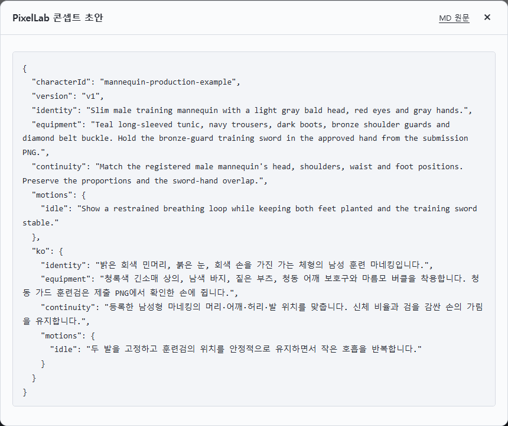
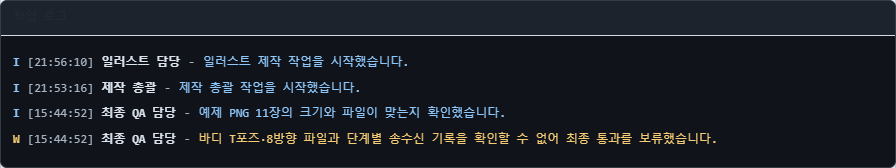

## 작업 결과

main에 ebde7f3d를 푸시했습니다.

## 변경 내용

### 적용 내용

## 검증

Chrome에서 인계·콘셉트·정렬 기록의 팝업과 상태 원 크기·회전을 확인했습니다. 실제 남성형 마네킹의 일러스트 시작 로그도 표시됐습니다.

## 남은 사항

공개 페이지 반영 미확인.

## 작업 시간

- 제안 시간: 4~6분
- 실제로 완료된 시간: 2026-11-21 21:59:28~22:02:23 KST, 2분 55초
- XERJ: 미사용 — 로컬 Chrome 및 Git으로 확인했습니다.
