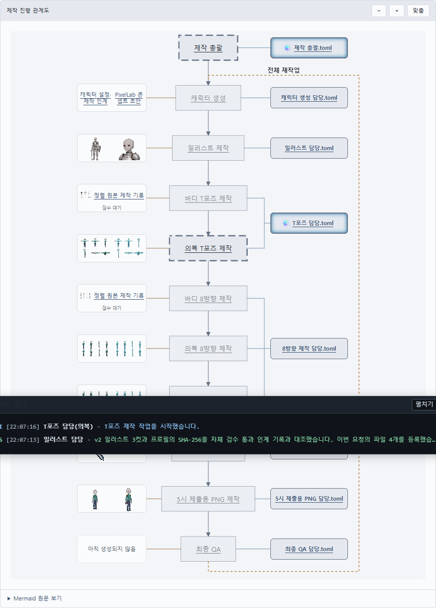

## 작업 결과

main에 0c0b2ae4를 푸시했습니다.

## 변경 내용

### 적용 내용

## 검증

인계 문서의 SHA-256과 PNG 4개를 대조하고 Chrome에서 현재 요청의 일러스트 및 등록 로그를 확인했습니다.

## 남은 사항

후속 제작과 최종 QA는 진행 중입니다. 공개 페이지 반영 미확인.

## 작업 시간

- 제안 시간: 별도 제안 없음
- 실제로 완료된 시간: 2026-11-21 22:06:35~22:08:06 KST, 1분 31초
- XERJ: 미사용 — 로컬 파일 해시, Chrome 및 Git으로 확인했습니다.
