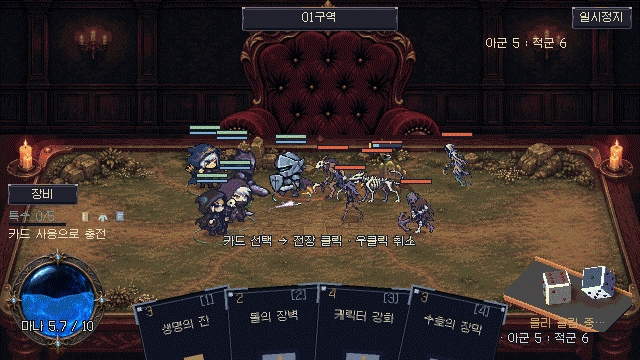

## 작업 결과

첫 명중에 콤보가 오른쪽 화면 밖에서 튀어나옵니다. 타격마다 숫자가 확대되며 섬광과 픽셀 불꽃이 터집니다.

## 변경 내용

### 적용 내용

10콤보부터 금색이 주황색으로 바뀝니다. 마지막 명중 2초 뒤 우측으로 퇴장합니다. 움직임 완화 설정에서는 위치 이동과 크기 변화를 줄입니다.

## 검증

Godot 4.7.2의 실제 5대6 전투에서 우측 등장, 13콤보까지의 명중 연출과 타격 종료 후 퇴장 장면을 캡처했습니다. 게임 코드는 main의 13070dbd에 푸시했습니다.

## 남은 사항

별도 배포 빌드와 움직임 완화 설정 화면은 미확인입니다.

## 작업 시간

- 제안 시간: 6분
- 실제로 완료된 시간: 2026-11-21 22:07~22:09 KST, 약 2분
- XERJ: 미사용 — Godot 렌더링과 콤보 변경 로그를 대조했습니다.
