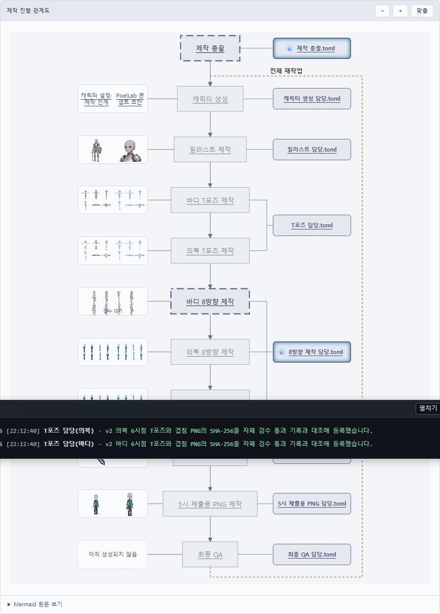

## 작업 결과

main에 5f759661을 푸시했습니다.

## 변경 내용

### 적용 내용

## 검증

인계 SHA-256 대조와 Chrome의 실제 미리보기, 임시 요청의 미등록 차단 및 등록 뒤 진행을 확인했습니다.

## 남은 사항

후속 작업이 진행 중인 로컬 서버는 현재 실행을 유지합니다. 새 요청의 차단 규칙은 서버 재시작 후 적용됩니다. 공개 페이지 미확인.

## 작업 시간

- 제안 시간: 별도 제안 없음
- 실제로 완료된 시간: 2026-11-21 22:11:59~22:14:06 KST, 2분 7초
- XERJ: 미사용 — 로컬 Chrome, 해시, 요청 CLI 및 Git으로 확인했습니다.
