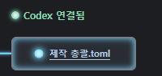

## 작업 결과

main에 6970fc64를 푸시했습니다.

## 변경 내용

### 적용 내용

## 검증

로컬 Chrome의 모의 연결 및 작업 상태에서 두 원의 크기, 중심, 그림자 변화를 확인했습니다.

## 남은 사항

공개 페이지 반영 미확인.

## 작업 시간

- 제안 시간: 5분
- 실제로 완료된 시간: 22:20:29~22:22:22 KST, 1분 53초
- XERJ: 미사용 — 로컬 Chrome에서 실제 화면을 캡처했습니다.
