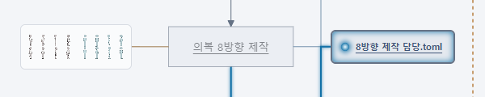

## 작업 결과

main에 7753fe61을 푸시했습니다.

## 변경 내용

### 적용 내용

## 검증

파일 해시를 자체 검수 기록과 대조했고, 로컬 Chrome에서 실제 의복 미리보기 경로와 디코딩을 확인했습니다.

## 남은 사항

공개 페이지 반영 미확인.

## 작업 시간

- 제안 시간: 5분
- 실제로 완료된 시간: 22:23:02~22:24:16 KST, 1분 14초
- XERJ: 미사용 — 로컬 Chrome에서 실제 카드를 캡처했습니다.
