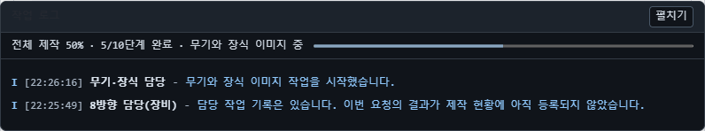

## 작업 결과

main에 2d6e5d4a를 푸시했습니다.

## 변경 내용

### 적용 내용

## 검증

로컬 Chrome에서 예제 두 이름을 클릭하고 작업 로그 안의 진행률과 현재 단계를 확인했습니다.

## 남은 사항

공개 페이지 반영 미확인.

## 작업 시간

- 제안 시간: 5분
- 실제로 완료된 시간: 22:27:02~22:28:27 KST, 1분 25초
- XERJ: 미사용 — 로컬 Chrome에서 고정 로그를 캡처했습니다.
