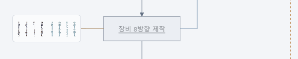

## 작업 결과

main에 1cad294a를 푸시했습니다.

## 변경 내용

### 적용 내용

## 검증

로컬 Chrome에서 장비 이미지 로딩을 확인했고 임시 요청으로 등록 전 인계 차단 및 등록 후 시작을 확인했습니다.

## 남은 사항

공개 페이지 반영 미확인.

## 작업 시간

- 제안 시간: 5분
- 실제로 완료된 시간: 22:29:05~22:30:52 KST, 1분 47초
- XERJ: 미사용 — 로컬 Chrome과 CLI에서 확인했습니다.
