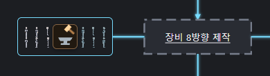

## 작업 결과

main에 54a1330d를 푸시했습니다.

## 변경 내용

### 적용 내용

## 검증

로컬 Chrome 모의 실행에서 기존 이미지 위 표시와 종료 후 숨김을 확인했습니다. GIF 16프레임을 검증했습니다.

## 남은 사항

공개 페이지 반영 미확인.

## 작업 시간

- 제안 시간: 5분
- 실제로 완료된 시간: 22:31:21~22:33:15 KST, 1분 54초
- XERJ: 미사용 — 로컬 Chrome의 실제 화면을 캡처했습니다.
