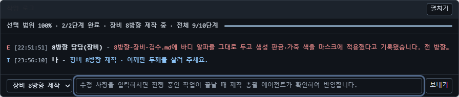

## 작업 결과

main에 24b2b65c를 푸시했습니다.

## 변경 내용

### 적용 내용

## 검증

Chrome 모의 화면에서 안내, Enter 전송, 최신 기록 위치를 확인했습니다. 임시 요청으로 API 저장·다음 단계 차단·지정 단계 재실행 허용을 확인했습니다.

## 남은 사항

기존 서버 재시작 및 실제 총괄 재작업 실행은 미확인.

## 작업 시간

- 제안 시간: 8분
- 실제로 완료된 시간: 22:53:31~22:56:50 KST, 3분 19초
- XERJ: 미사용 — 코드 검색 근거가 제공되지 않았습니다.
