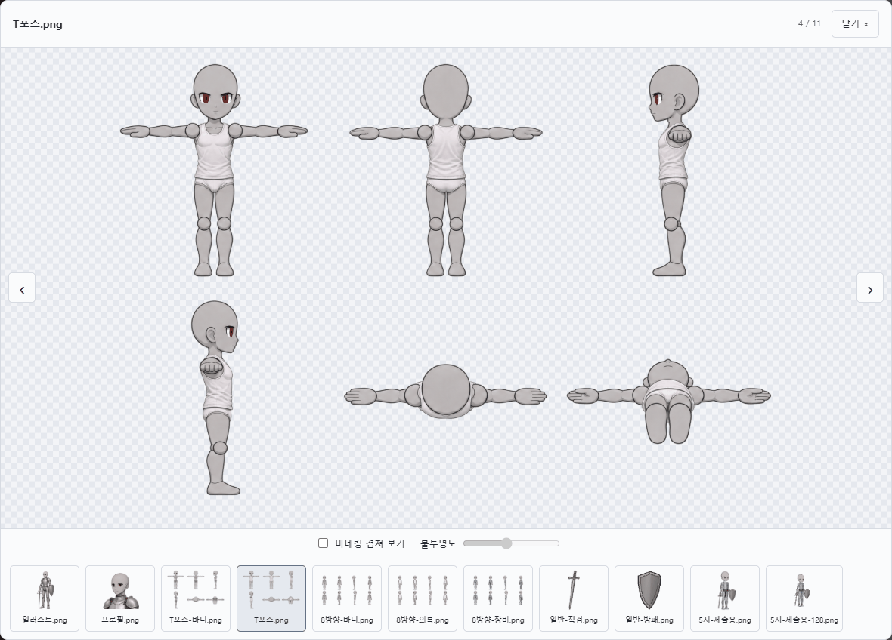
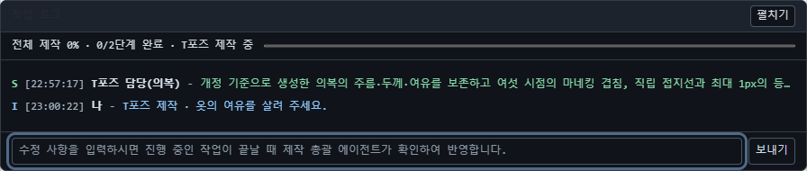

## 작업 결과

main에 2110b411을 푸시했습니다.

## 변경 내용

### 적용 내용

## 검증

별도 포트 Chrome에서 기존 실행 형식의 입력란, Enter 전송, 실제 T포즈 겹침 켜기와 끄기를 확인했습니다.

## 남은 사항

기존 포트 서버는 실행 중인 제작을 위해 유지했습니다. 실제 제작 총괄의 지시 반영은 미확인입니다.

## 작업 시간

- 제안 시간: 5분
- 실제로 완료된 시간: 22:57:31~23:00:46 KST, 3분 15초
- XERJ: 미사용 — 코드 검색 근거가 제공되지 않았습니다.
