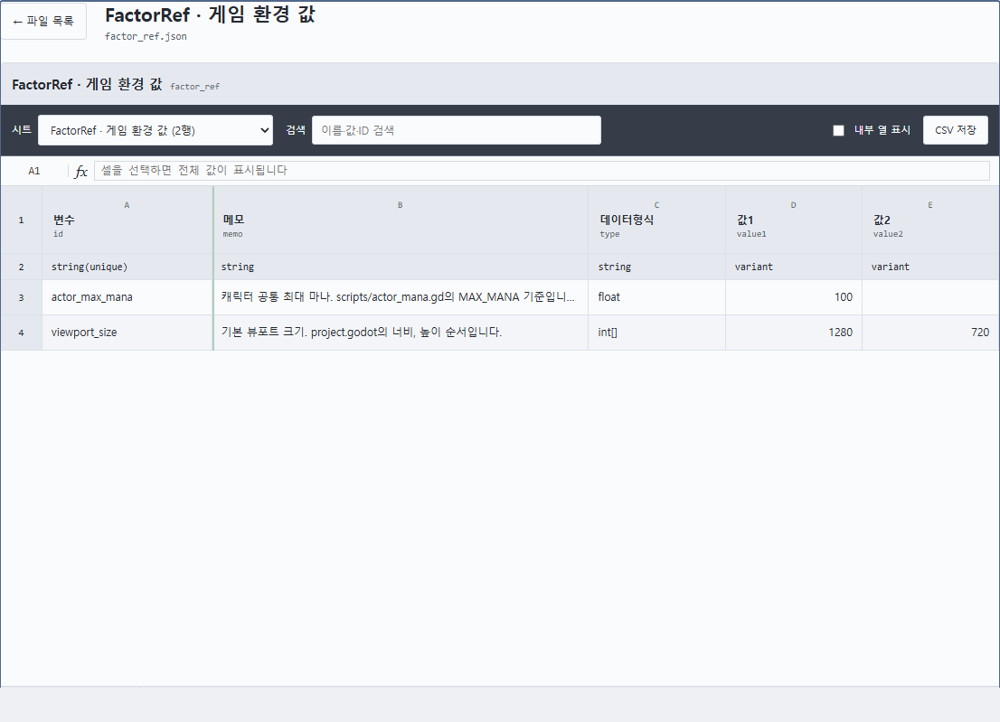
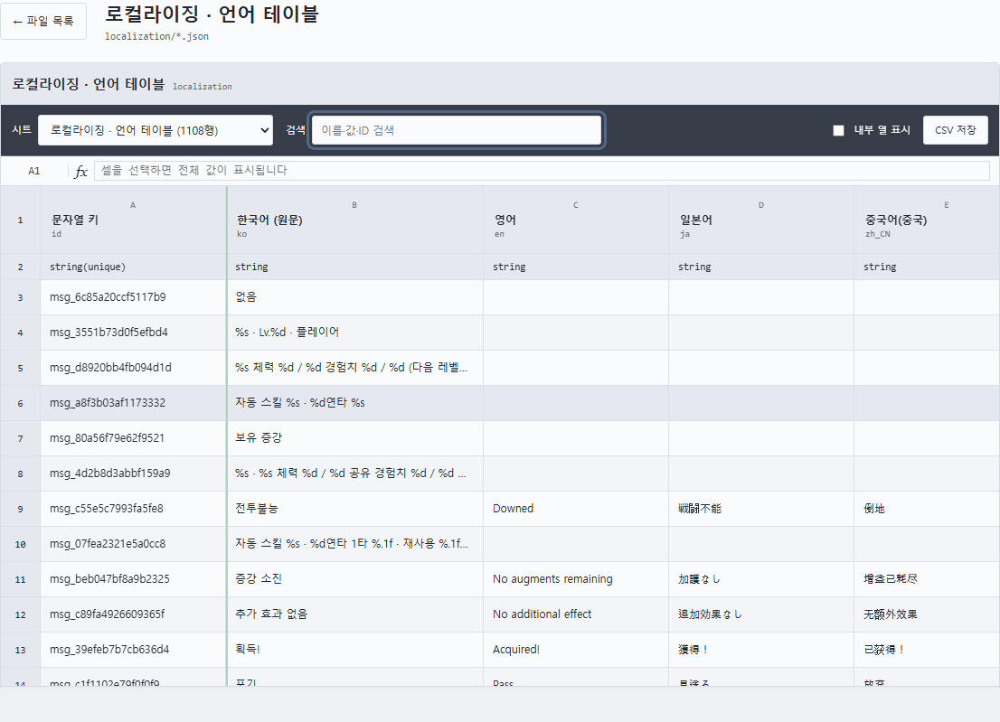

## 작업 결과

## 변경 내용

### 적용 내용

FactorRef의 배열을 값 열로 펼치고 한국어 원문과 언어별 번역 JSON을 메시지 키로 연결했습니다.

## 검증

Chrome에서 파일 목록 진입, FactorRef 배열 및 CSV, 로컬라이징 11개 언어 열·1,108개 행·미번역 빈 셀과 실제 캡처를 확인했습니다.

## 남은 사항

게임 런타임은 기존 설정을 사용합니다. 대시보드와 중앙 보고서의 공개 배포는 미확인입니다.

## 작업 시간

- 제안 시간: 약 10분
- 실제로 완료된 시간: 로컬 검수 약 2분, 23:19 KST 완료.
- XERJ: 미사용 — Node 및 Chrome 검수
