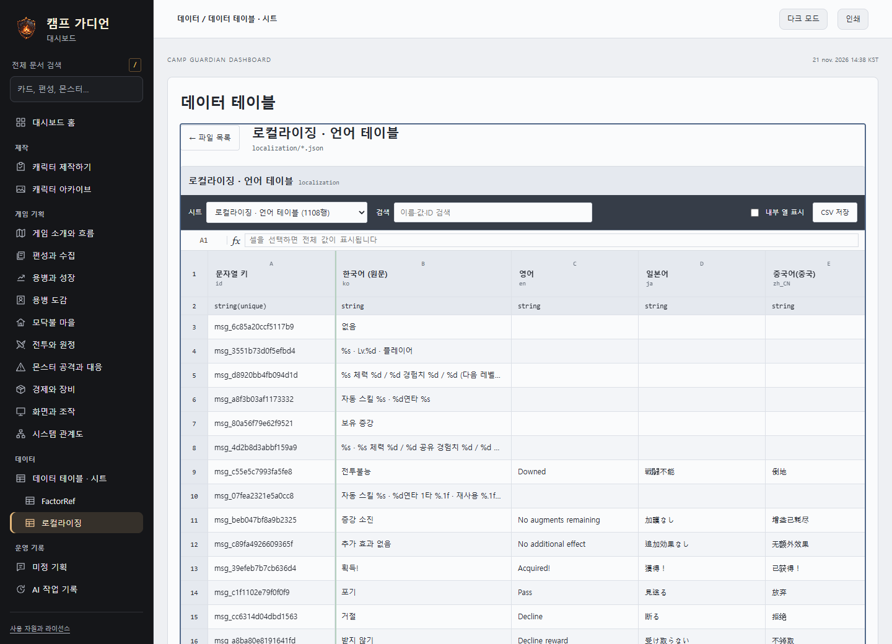

## 작업 결과

## 변경 내용

### 적용 내용

사이드바에 FactorRef와 로컬라이징을 순서대로 배치하고 기존 파일 목록에서 중복 항목을 제거했습니다.

## 검증

Chrome에서 탭 순서, 두 시트 진입, 선택 표시, 새로고침 및 기존 파일 40개 목록 복귀를 확인했습니다.

## 남은 사항

공개 페이지 반영 미확인.

## 작업 시간

- 제안 시간: 약 5분
- 실제로 완료된 시간: 로컬 검수 약 1분, 23:23 KST 완료.
- XERJ: 미사용 — Chrome 실제 화면
