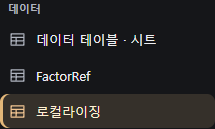

## 작업 결과

## 변경 내용

### 적용 내용

FactorRef와 로컬라이징 메뉴의 들여쓰기를 제거했습니다.

## 검증

Chrome에서 세 메뉴 아이콘의 가로 위치가 같고 두 시트에 접근할 수 있음을 확인했습니다.

## 남은 사항

공개 배포 미확인.

## 작업 시간

- 제안 시간: 약 2분
- 실제로 완료된 시간: 로컬 구현·검수 약 20초, 23:48 KST 완료.
- XERJ: 미사용 — Chrome 실제 화면
