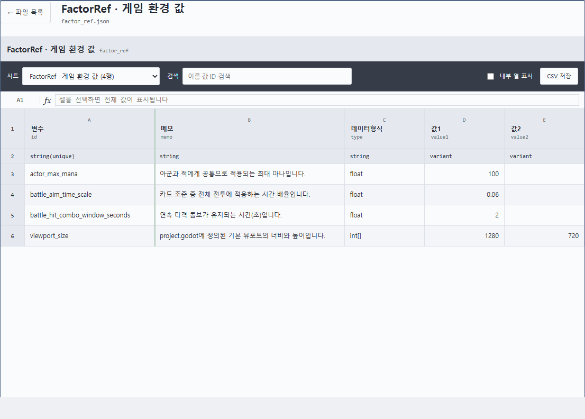
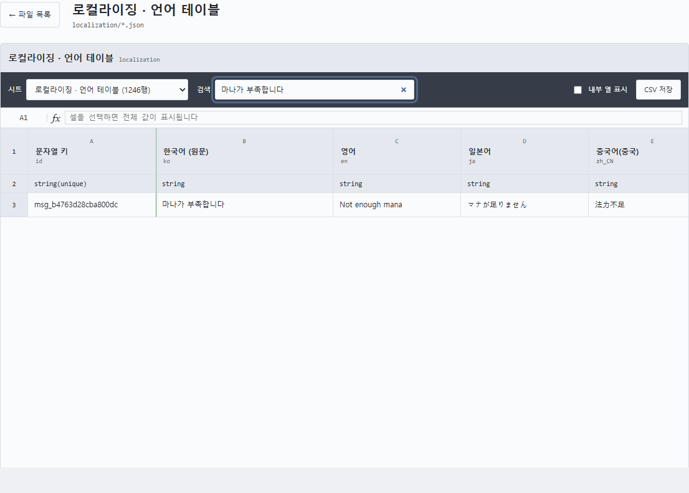

## 작업 결과

## 변경 내용

### 적용 내용

기존 122개를 배포 목록에서 제외하고 누락된 267개를 추가했습니다. 문자열 1,246개에 10개 대상 언어를 채웠습니다. 언어당 958개는 자동 번역 초안입니다. 최대 마나 100, 카드 조준 속도 0.06, 연속 타격 유지 시간 2초를 FactorRef에서 읽습니다. 뷰포트 크기는 project.godot에서 표시합니다.

## 검증

Godot에서 전투 진입과 세 환경 값, 영어 카드명과 슬롯 안내를 확인했습니다. 번역 생성기에서 자리표시자와 빈 셀을 확인했고 Chrome에서 두 시트와 제거된 문구 검색을 확인했습니다. 프로젝트 커밋 dbbf8693 푸시.

## 남은 사항

자동 번역의 전체 문맥, UI 길이 및 지역별 표현 검토와 공개 배포 여부는 미확인입니다.

## 작업 시간

- 제안 시간: 초기 점검 약 3분, 이후 언어팩 처리 및 검증 약 2분 추가 안내
- 실제로 완료된 시간: 약 11분, 로컬 구현·검수 2026-11-22 00:01 KST 완료.
- XERJ: 미사용 — Godot과 Chrome 실행
