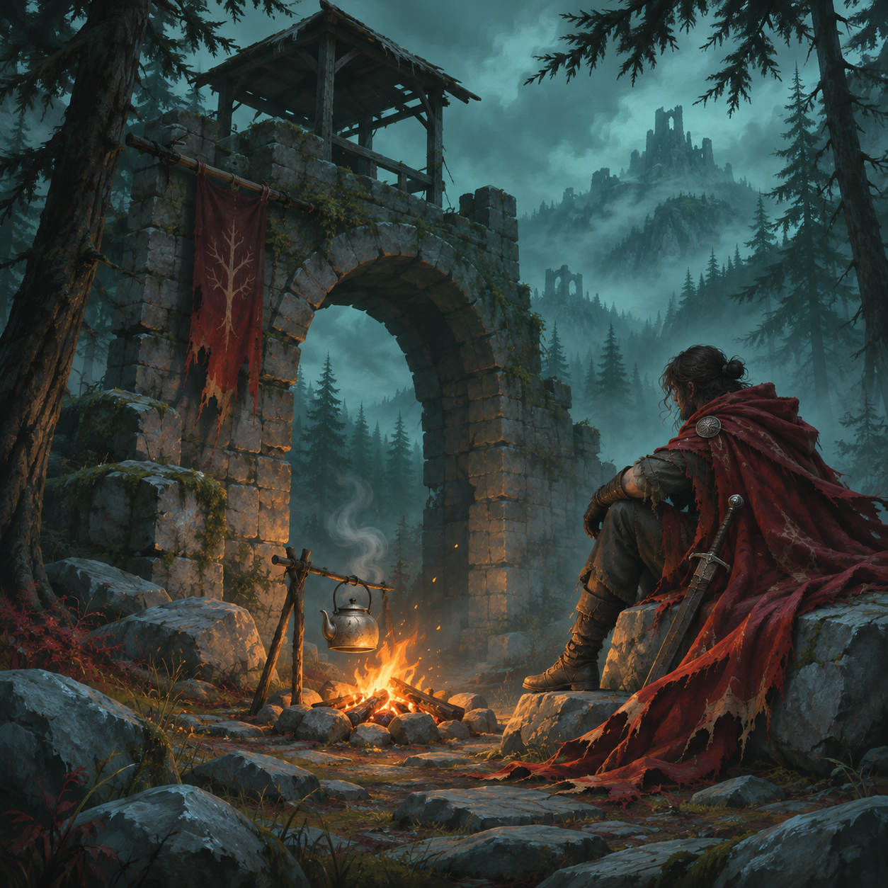
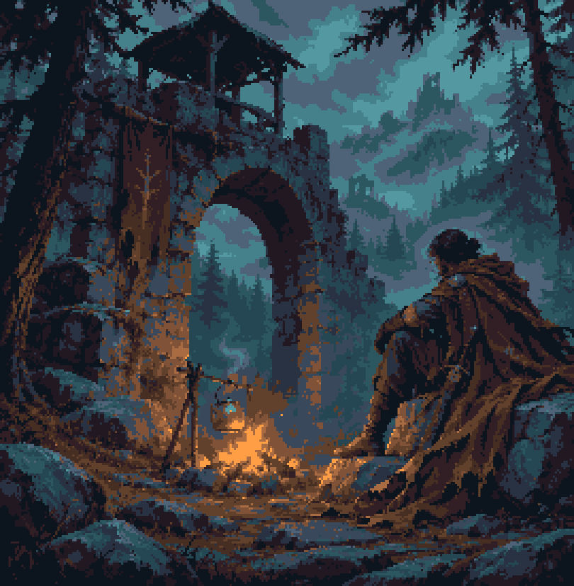
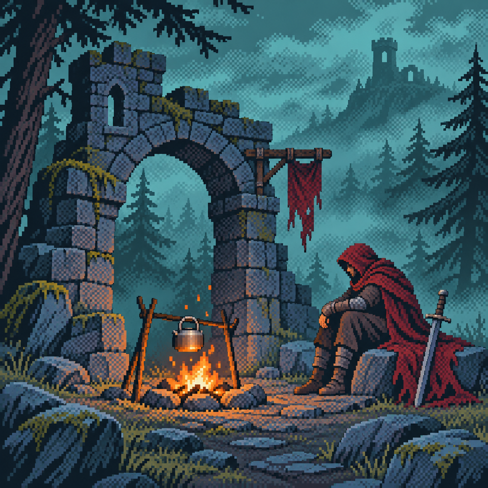
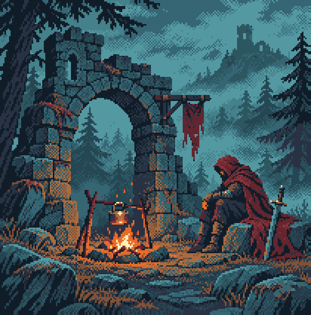

## 작업 결과

ImageGen 원본 두 장과 Pixel Snapper 변환 두 장을 비교했습니다.

## 변경 내용

### 적용 내용

공식 웹 워커와 WASM을 로컬에서 실행하고 격자는 자동 감지했습니다. 후처리 이미지는 표시용으로 최근접 3배 확대했습니다.

## 검증

일반 1254×1254 → 270×276, 15색. 도트풍 1254×1254 → 206×209, 13색. 두 출력의 전체 픽셀이 지정한 32색 안에 들어가는 것을 확인했습니다.

## 남은 사항

이번 팔레트는 비교 예제에 사용했습니다.

## 작업 시간

- 제안 시간: 7~10분
- 실제로 완료된 시간: 2026-11-22 09:14:56~09:18:09 KST, 생성 및 픽셀 검증 3분 13초
- XERJ: 미사용 — 공식 WASM 처리 결과를 직접 검사했습니다.
