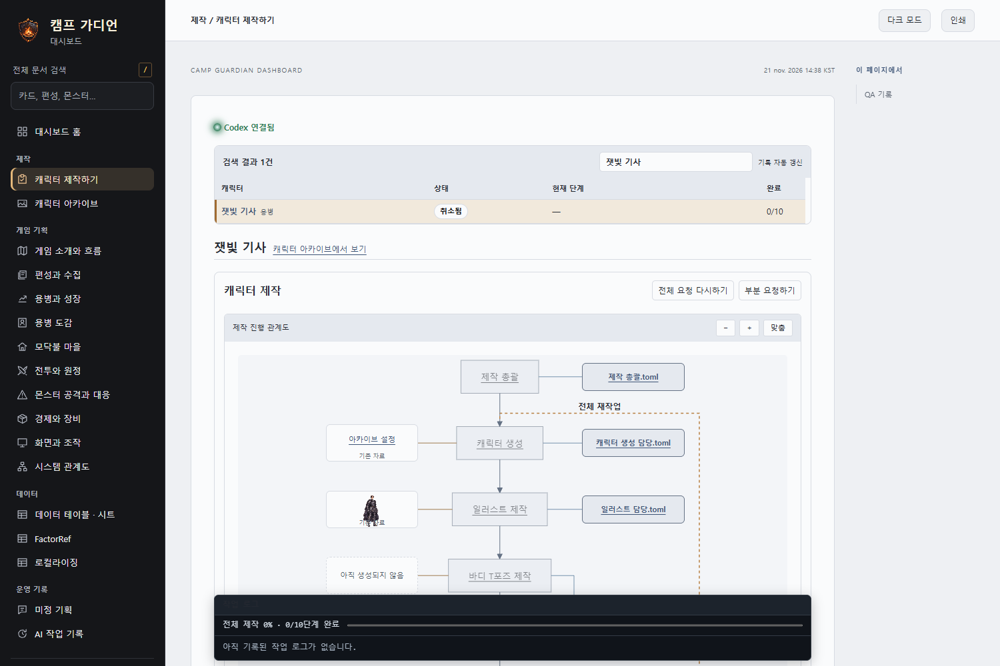

## 작업 결과

프로젝트 main e786cc58 푸시.

## 변경 내용

### 적용 내용

## 검증

Chrome에서 실제 Codex 연결 API, 제작 영역 활성화, 검색과 아카이브 이동을 확인했습니다.

## 남은 사항

공개 페이지 반영 및 정적 주소의 로컬 전환 미확인.

## 작업 시간

- 제안 시간: 8분
- 실제로 완료된 시간: 09:17:17~09:19:29 KST, 2분 12초
- XERJ: 미사용 — 코드 검색 근거가 제공되지 않았습니다.
