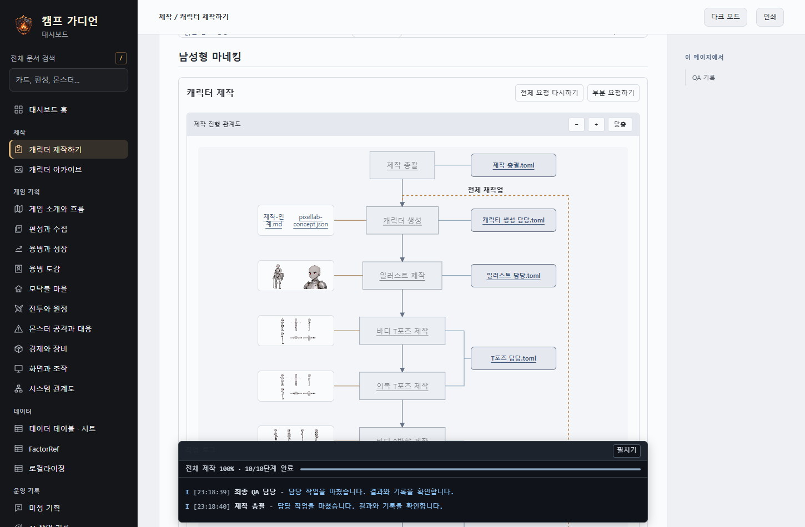

## 작업 결과

프로젝트 main 4aacfaec 푸시.

## 변경 내용

### 적용 내용

## 검증

포트가 닫힌 상태에서 Windows URI 호출 후 실제 연결 API가 성공했습니다. 같은 트레이에서 서버 재시작을 확인했고 Chrome 파일 대시보드의 로컬 연결도 확인했습니다.

## 남은 사항

Chrome 외부 앱 확인창부터 서버 시작까지의 연속 동작과 트레이 우클릭 화면은 미확인.

## 작업 시간

- 제안 시간: 8분
- 실제로 완료된 시간: 09:24:24~09:27:08 KST, 2분 44초
- XERJ: 미사용 — 코드 검색 근거가 제공되지 않았습니다.
