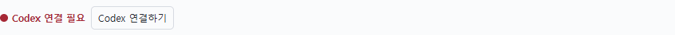

## 작업 결과

프로젝트 main 521ae24c 푸시.

## 변경 내용

### 적용 내용

## 검증

실제 트레이 서버 중지와 시작 뒤 같은 Chrome 페이지에서 연결 상태와 제작 영역이 복구되는 것을 확인했습니다.

## 남은 사항

공개 페이지 반영 미확인.

## 작업 시간

- 제안 시간: 5분
- 실제로 완료된 시간: 09:49:29~09:50:32 KST, 1분 3초
- XERJ: 미사용 — 코드 검색 근거가 제공되지 않았습니다.
