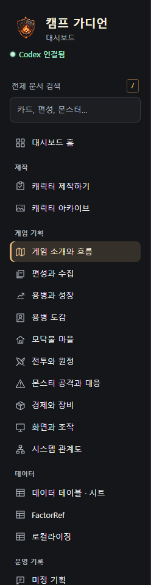

## 작업 결과

프로젝트 main 5f477092 푸시.

## 변경 내용

### 적용 내용

## 검증

Chrome에서 게임 소개와 캐릭터 제작 페이지의 동일 연결 위치와 실제 연결을 확인했습니다.

## 남은 사항

공개 페이지 반영과 제작 외 페이지에서 서버 재시작 후 복구는 미확인.

## 작업 시간

- 제안 시간: 5분
- 실제로 완료된 시간: 09:56:46~09:58:13 KST, 1분 27초
- XERJ: 미사용 — 코드 검색 근거가 제공되지 않았습니다.
