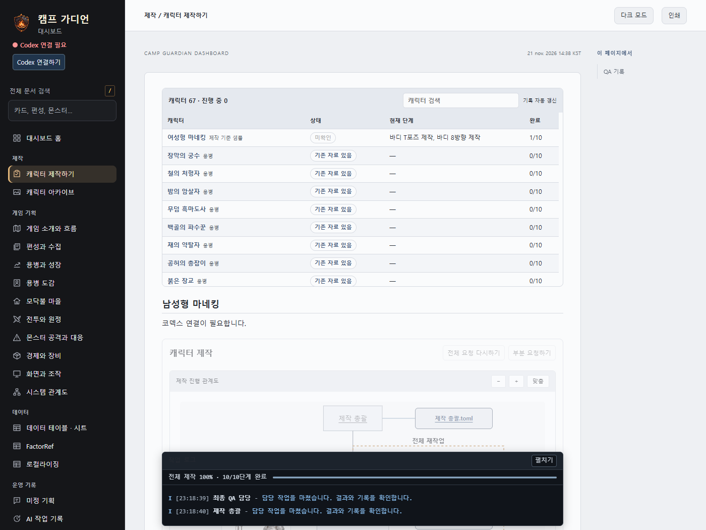

## 작업 결과

프로젝트 main b54edc8c 푸시.

## 변경 내용

### 적용 내용

## 검증

Chrome에서 모의 연결 실패 시 안내, 실제 재연결 뒤 숨김과 제작 영역 활성화, 메뉴 아이콘과 동일한 시작점을 확인했습니다.

## 남은 사항

공개 페이지 반영 미확인.

## 작업 시간

- 제안 시간: 3분
- 실제로 완료된 시간: 09:59:21~10:01:02 KST, 1분 41초
- XERJ: 미사용 — 코드 검색 근거가 제공되지 않았습니다.
