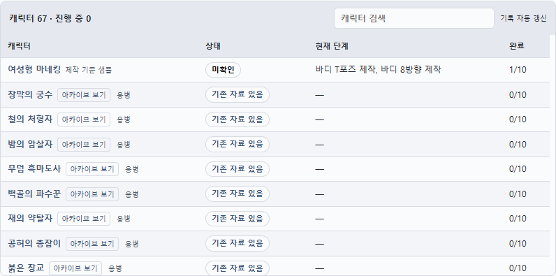

## 작업 결과

프로젝트 main eac20a39 푸시.

## 변경 내용

### 적용 내용

## 검증

Chrome에서 잿빛 기사 이름 바로 옆 단축 링크와 해당 상세 이동을 확인했습니다.

## 남은 사항

공개 페이지 반영 미확인.

## 작업 시간

- 제안 시간: 3분
- 실제로 완료된 시간: 10:16:14~10:17:16 KST, 1분 2초
- XERJ: 미사용 — 코드 검색 근거가 제공되지 않았습니다.
