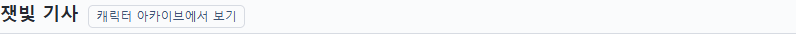

## 작업 결과

main 67878cc6 푸시.

## 변경 내용

### 적용 내용

## 검증

Chrome에서 게시물 제목 옆 위치와 잿빛 기사 상세 및 마네킹의 아카이브 목록 연결을 확인했습니다.

## 남은 사항

공개 페이지 반영 미확인.

## 작업 시간

- 제안 시간: 3분
- 실제로 완료된 시간: 10:18:31~10:19:21 KST, 50초
- XERJ: 미사용 — 코드 검색 근거가 제공되지 않았습니다.
