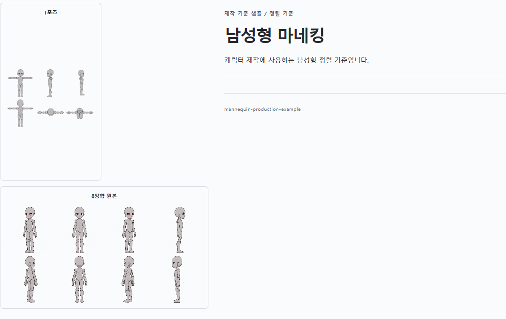

## 작업 결과

main 6b2c8f05 푸시.

## 변경 내용

### 적용 내용

## 검증

Chrome에서 남성형·여성형 마네킹과 잿빛 기사의 버튼을 눌러 각 상세 화면 제목과 주소를 확인했습니다.

## 남은 사항

공개 페이지 반영 미확인.

## 작업 시간

- 제안 시간: 5분
- 실제로 완료된 시간: 10:23:17~10:25:33 KST, 2분 16초
- XERJ: 미사용 — 코드 검색 근거가 제공되지 않았습니다.
