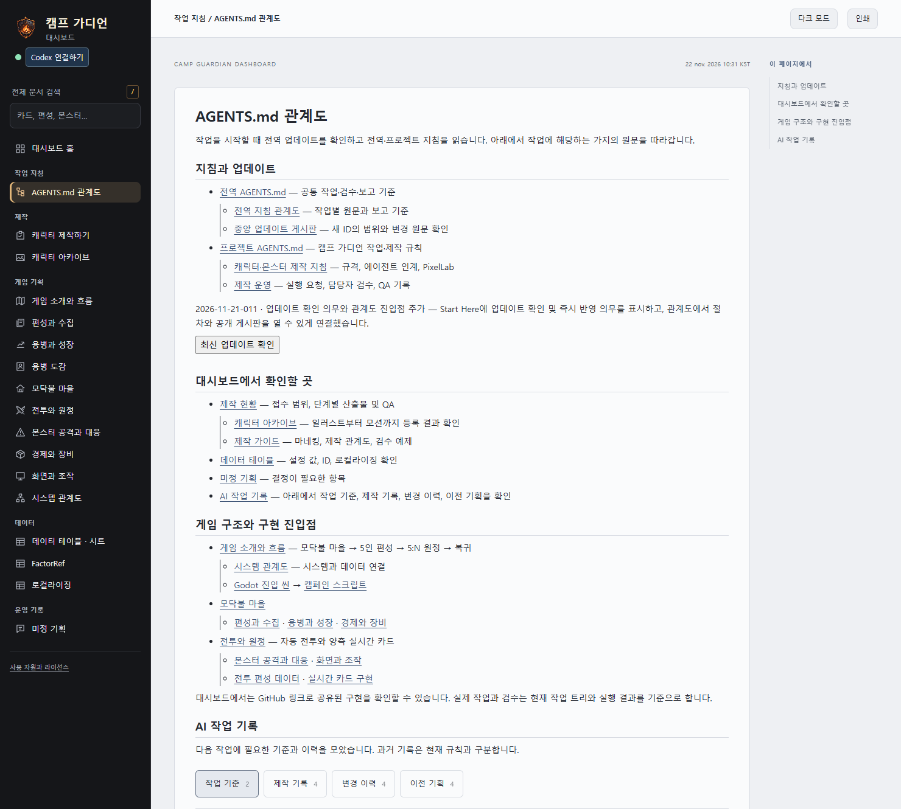

## 작업 결과

지침·대시보드·게임 구조를 세 가지로 정리하고 기존 작업 기록 4개 분류를 관계도 안으로 옮겼습니다.

## 변경 내용

### 적용 내용

프로젝트 AGENTS.md에서 관계도를 참조하도록 연결했습니다. 작업 인계에 확정 결정, 원문, 실제 검증 범위와 미확인 항목, 후속 조치를 남기도록 작업 기준을 보강했습니다. 중앙 게시판 최신 항목을 탭 진입과 재조회에서 확인합니다. 프로젝트 main 커밋 c11ffa83 푸시를 확인했습니다.

## 검증

대시보드 빌드 성공. 실제 Chrome 렌더에서 계층, 원문 미리보기, 게임 문서 이동, AI 기록 탭과 기존 개별 링크, 전체 기록 건수를 확인했습니다. 중앙 최신 ID 2026-11-21-011을 원격에서 읽어 표시했습니다. 응답 교체로 재조회 반영을 확인했습니다.

## 남은 사항

공개 대시보드 배포와 모바일 실제 기기 상태는 미확인입니다. 이번 검증 범위는 대시보드와 문서입니다.

## 작업 시간

- 제안 시간: 10분. 시작 2026-11-22 10:24 KST.
- 실제로 완료된 시간: 2026-11-22 10:32:48 KST 검증 완료. 약 8분.
- XERJ: 미사용 — rg, Git, Node, Chrome 헤드리스로 확인했습니다.
