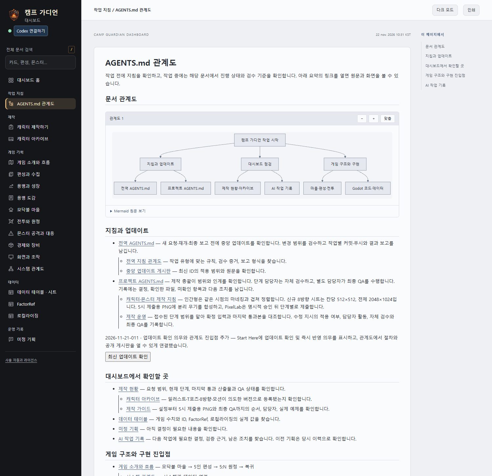

## 작업 결과

전역·프로젝트 지침, 제작 현황과 AI 기록, 게임 기획과 구현을 세 갈래로 표시합니다.

## 변경 내용

### 적용 내용

기존 링크 트리에 실제 연결형 Mermaid 다이어그램을 추가했습니다. 지침, 제작 운영, 데이터, 마을·편성·전투 문서 요약을 원문 링크 옆에 배치했습니다. 프로젝트 main에 a5b94c0d를 푸시했습니다.

## 검증

대시보드 빌드 성공. Chrome에서 다이어그램 노드 10개와 연결선 9개, 프로젝트 AGENTS.md 미리보기, AI 기록 이동, 390px 화면에서 페이지 가로 넘침 없음, 중앙 업데이트 2026-11-21-011을 확인했습니다. 전체 화면 PNG를 열어 글자와 연결선을 확인했습니다.

## 남은 사항

모바일 실기기와 공개 대시보드 배포는 미확인입니다.

## 작업 시간

- 제안 시간: 8분. 11월 22일 10:51 KST 시작.
- 실제로 완료된 시간: 11월 22일 10:53:52 KST까지 약 2분.
- XERJ: 미사용 — rg, 대시보드 빌드, Chrome 실행 및 로컬 화면 검수.
