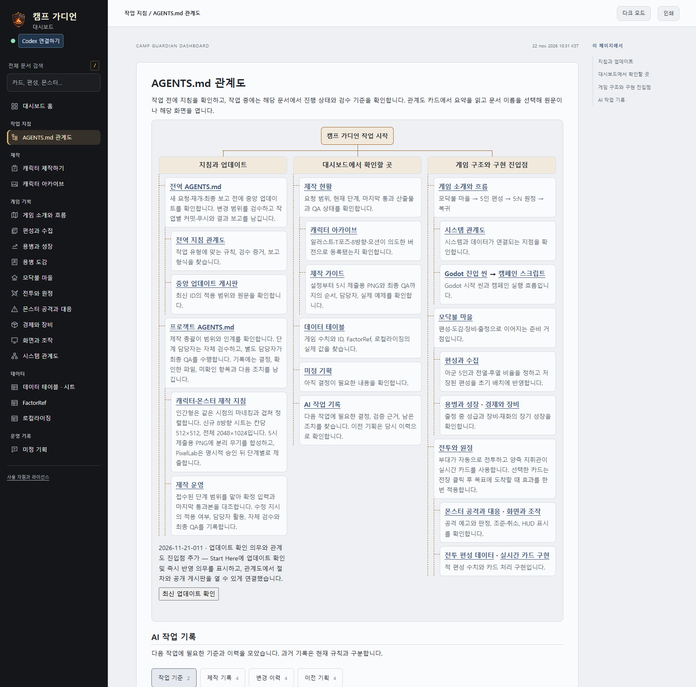

## 작업 결과

카드 21개가 세 가지 주제에 연결됩니다.

## 변경 내용

### 적용 내용

샘플 프로젝트의 카드 배치와 본문 열기 동작을 실제 화면에서 대조했습니다. 기존 그림과 아래 요약 목록을 통합했습니다. 프로젝트 main에 b0147893을 푸시했습니다.

## 검증

대시보드 빌드와 Chrome 캡처를 확인했습니다. 모든 카드에 요약이 있고 별도 요약 목록이 없음을 확인했습니다. 프로젝트 지침 미리보기, AI 작업 기록 이동, 390px 가로 넘침 여부와 중앙 업데이트 ID 2026-11-21-011을 확인했습니다.

## 남은 사항

공개 대시보드 배포와 모바일 실기기 표시는 미확인입니다.

## 작업 시간

- 제안 시간: 8분. 10:56 KST 시작.
- 실제로 완료된 시간: 11월 22일 10:59 KST 완료. 약 3분.
- XERJ: 미사용 — rg, Node, Chrome 헤드리스 실행으로 검증했습니다.
