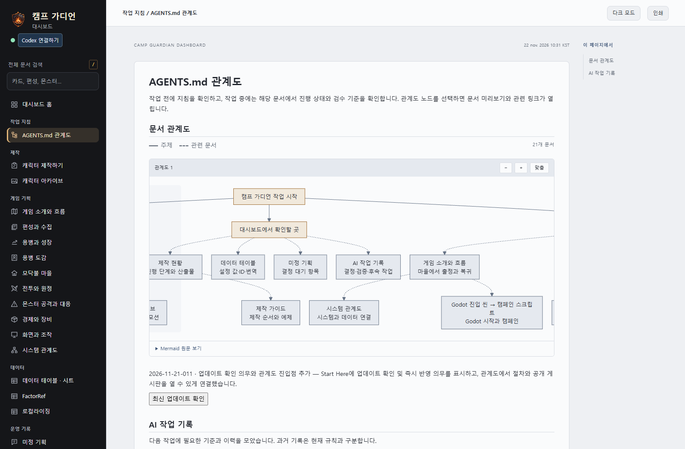
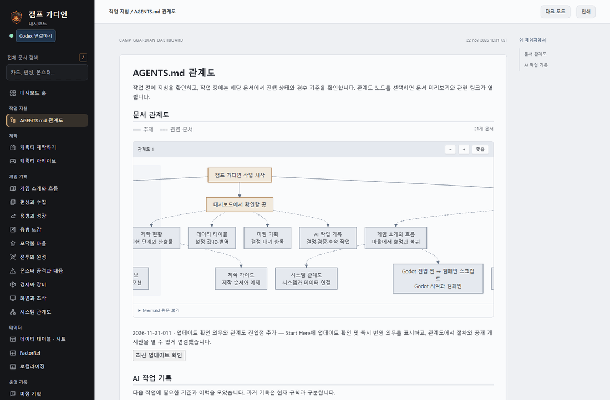

## 작업 결과

문서 21개와 주제·시작점 4개를 렌더링하고 각 문서 노드에 한 줄 요약과 미리보기 동작을 연결했습니다.

## 변경 내용

### 적용 내용

샘플 프로젝트는 자체 SVG 연결선, 노드 요약, 문서 본문 모달, 원문 링크, 실선·점선 범례, 문서 수, 가로 탐색을 제공합니다. 캠프 가디언은 Mermaid SVG로 렌더링하며, 동일한 탐색 기능과 대시보드의 확대·축소·맞춤을 제공합니다. 외부 자료는 미리보기에서 짧은 요약과 원문 링크를 표시합니다.

## 검증

실제 Chrome에서 25개의 초점 가능한 SVG 노드, 프로젝트 AGENTS.md 본문, Enter와 Escape, 닫힌 뒤 노드 초점 복귀, AI 작업 기록 이동, 외부 원문 링크, 확대와 맞춤을 확인했습니다. 프로젝트 main ad212a23 푸시를 확인했습니다.

## 남은 사항

모바일 실기기와 공개 배포는 미확인입니다.

## 작업 시간

- 제안 시간: 두 작업 합계 10분. 11월 22일 11:05 KST 시작.
- 실제로 완료된 시간: 11월 22일 11:11 KST까지 약 6분.
- XERJ: 미사용 — rg와 샘플 HTML, Node 빌드, 실제 Chrome 확인.
