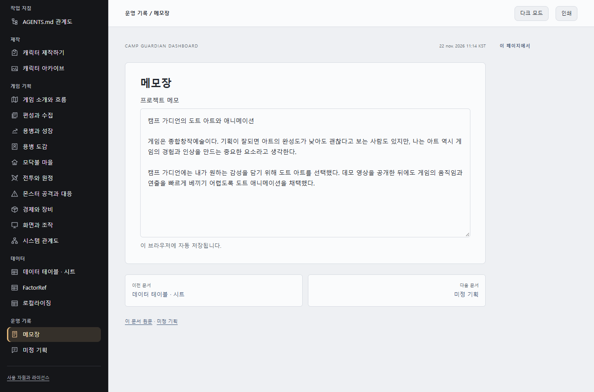

## 작업 결과

메모장 탭과 첫 메모를 구현하고 프로젝트 main에 푸시했습니다.

## 변경 내용

### 적용 내용

대시보드 메뉴, 직접 진입 경로와 지침 관계도에 메모장을 연결했습니다. 입력한 내용은 브라우저에 자동 저장합니다.

## 검증

대시보드 빌드와 Chromium에서 메뉴 진입, 기본 메모 표시, 새로고침 후 편집 유지 확인. 프로젝트 커밋 e9ccbc50.

## 남은 사항

공개 대시보드 배포 확인은 미확인입니다.

## 작업 시간

- 제안 시간: 약 10분
- 실제로 완료된 시간: 11:10에 시작해 약 5분 후 11:15에 구현·검증 및 프로젝트 푸시 완료 (KST)
- XERJ: 미사용 — rg로 대시보드 코드 위치 확인
