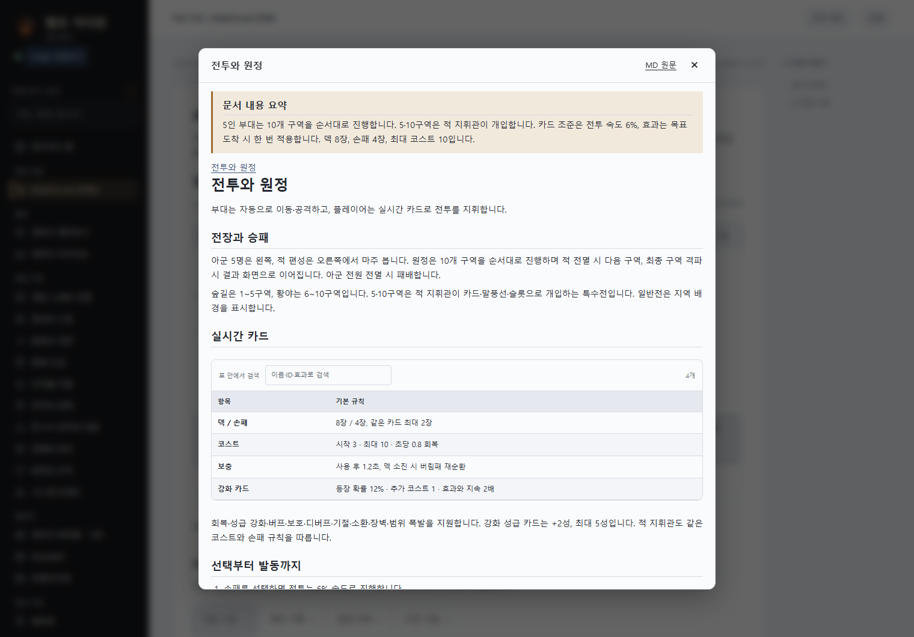

## 작업 결과

관계도 모달 상단에 22개 문서 노드의 원문 기반 요약을 배치했습니다.

## 변경 내용

### 적용 내용

전투 수치·제작 규격·승인과 검수·인계·데이터 위치 등 작업에 직접 필요한 내용을 원문에서 추려 요약했습니다. main 4f338091에 푸시했습니다.

## 검증

빌드 성공. 실제 Chrome에서 요약 22개와 전투·캐릭터 제작·전역 지침·메모장 예시를 확인했습니다. 중앙 업데이트 ID 2026-11-22-001 원격 검증 완료.

## 남은 사항

요약은 원문이 바뀔 때 함께 갱신해야 합니다. 실제 시간 절감량, 공개 배포는 미확인입니다.

## 작업 시간

- 제안 시간: 8분. 11월 22일 14:25 KST 시작.
- 실제로 완료된 시간: 11월 22일 14:27 KST까지 약 2분.
- XERJ: 미사용 — rg, Markdown 원문 대조, 대시보드 빌드 및 Chrome 검증.
