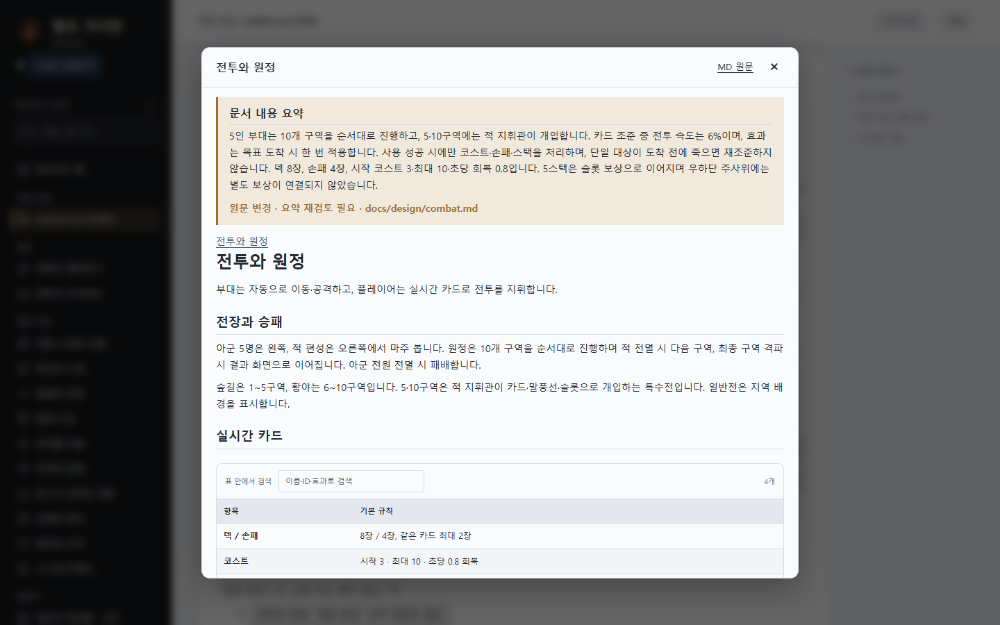

## 작업 결과

22개 요약의 검토 기준을 등록했습니다. 전투 원문과 캐릭터 제작 요약에 판정 예외, 수치와 승인 기준을 보강했습니다.

## 변경 내용

### 적용 내용

프로젝트 AGENTS.md에 원문과 모달 요약을 같은 작업에서 대조하고 검토를 기록하도록 추가했습니다. 로컬 원문은 대시보드 빌드에서 마지막 검토와 비교하며, 외부 원문은 브라우저에서 확인합니다. 다른 문서는 관계도 내 검토 상태 목록과 해당 모달에 표시합니다. main b05eed01 푸시를 확인했습니다.

## 검증

원문만 임시 변경한 전투 문서를 빌드해 목록과 모달의 경고 및 파일 경로를 Chrome에서 확인했습니다. 원문 복원 및 정상 빌드 뒤 경고가 사라졌습니다. 외부 원문 변경 응답도 별도로 확인했습니다. 중앙 최신 지침 2026-11-22-001을 원격 검증했습니다.

## 남은 사항

공개 대시보드 및 중앙 보고서의 공개 배포는 미확인입니다.

## 작업 시간

- 제안 시간: 10분. 11월 22일 15:05 KST 시작.
- 실제로 완료된 시간: 11월 22일 15:10 KST까지 약 5분.
- XERJ: 미사용 — rg, 원문 대조, Node 빌드, Chrome 확인으로 검증했습니다.
