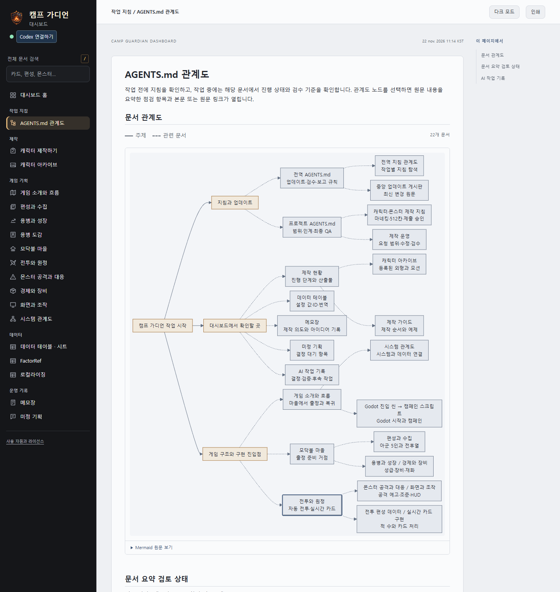

## 작업 결과

모든 문서를 화면 폭 안에서 탐색할 수 있고 요약 및 검토 상태에 접근할 수 있습니다.

## 변경 내용

### 적용 내용

데스크톱 관계도를 가로 방향으로 배치하고 SVG를 컨테이너 폭에 맞췄습니다. 좁은 영역에서는 같은 문서 계층과 모달을 세로 트리로 제공합니다. 프로젝트 main 28675b86에 푸시했습니다.

## 검증

실제 Chrome에서 뷰포트 1440·1024·390px의 페이지 및 관계도 가로 넘침이 0이고 전투 요약 모달이 열리는 것을 확인했습니다. 중앙 지침 2026-11-22-001을 원격 확인했습니다.

## 남은 사항

모바일 실기기와 공개 배포는 미확인입니다.

## 작업 시간

- 제안 시간: 5분. 11월 22일 15:16 KST 시작.
- 실제로 완료된 시간: 11월 22일 15:18 KST까지 약 2분.
- XERJ: 미사용 — rg, Node 빌드, Chrome 및 로컬 화면 확인.
