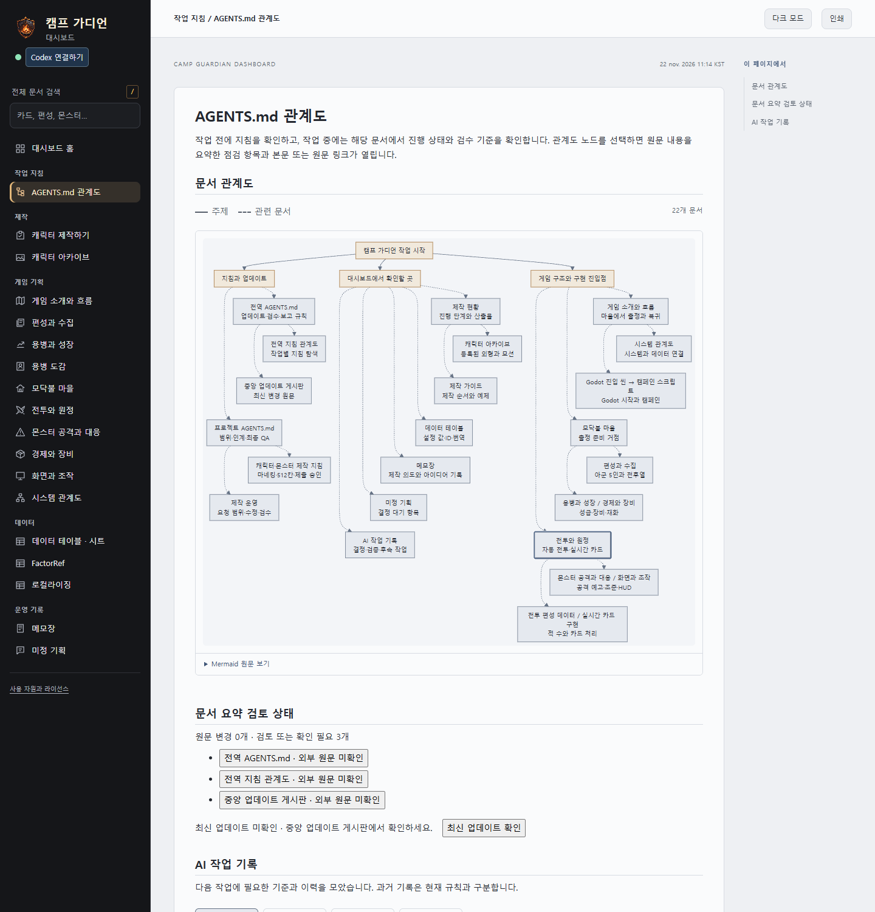

## 작업 결과

관계도가 화면 폭 안에서 위에서 아래로 이어집니다.

## 변경 내용

### 적용 내용

Mermaid 흐름을 위에서 아래로 바꾸고 가지별 문서를 세로로 배치했습니다. 프로젝트 main 9a42e7bd에 푸시했습니다.

## 검증

실제 Chrome에서 1440px의 시작점·주제·문서가 차례로 아래에 놓이는 것을 확인했습니다. 1440·1024·390px에서 가로 넘침이 없고 문서 모달이 열렸습니다. 중앙 업데이트 2026-11-22-001 원격 확인.

## 남은 사항

공개 배포와 모바일 실기기는 미확인입니다.

## 작업 시간

- 제안 시간: 5분. 11월 22일 15:43 KST 시작.
- 실제로 완료된 시간: 11월 22일 15:44 KST까지 약 1분.
- XERJ: 미사용 — Node 빌드, Chrome 실행과 화면 캡처.
