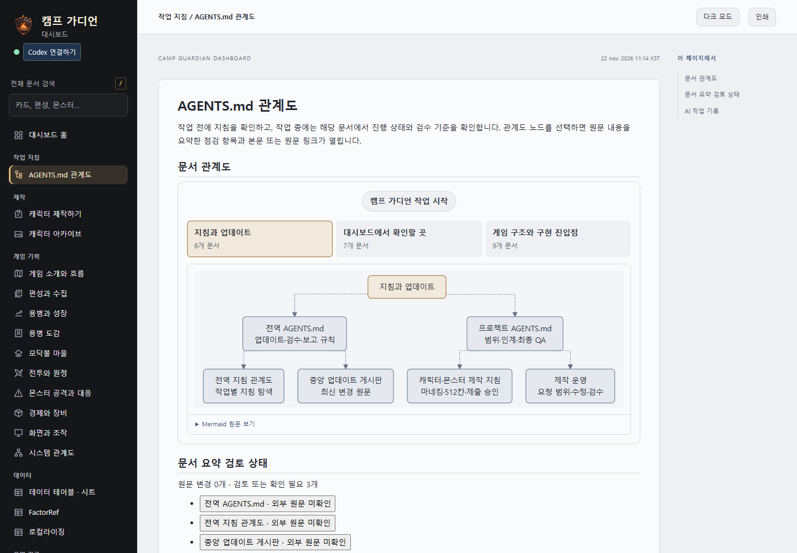

## 작업 결과

선택한 주제의 문서와 관련 문서를 읽을 수 있습니다.

## 변경 내용

### 적용 내용

세 주제 탭과 문서 수를 위에 배치하고 긴 교차 연결선을 줄였습니다. 모바일은 동일 주제의 세로 트리를 사용합니다. 프로젝트 main 8585b218을 푸시했습니다.

## 검증

18페이지 빌드 성공. 1440px와 390px Chrome에서 가로 넘침 없음, 탭 선택과 화살표 키, 전투 요약 모달을 확인했습니다. 원격 업데이트 2026-11-22-001 확인.

## 남은 사항

공개 배포와 모바일 실기기는 미확인입니다.

## 작업 시간

- 제안 시간: 6분. 11월 22일 16:05 KST 시작.
- 실제로 완료된 시간: 11월 22일 16:07 KST까지 약 2분 30초.
- XERJ: 미사용 — Node 빌드와 실제 Chrome 화면 확인.
