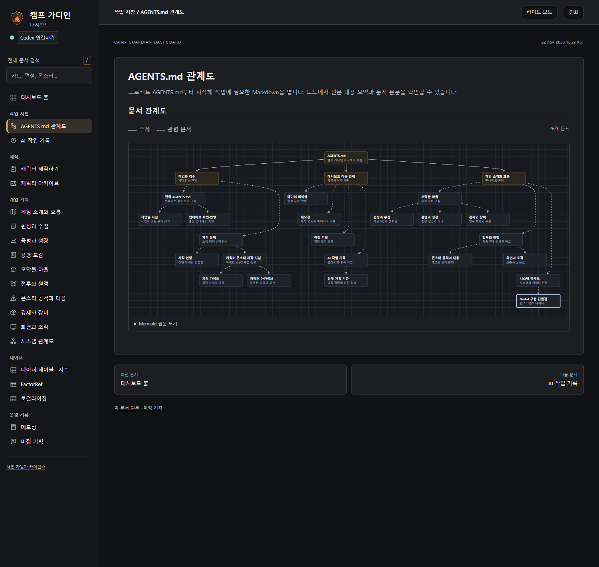
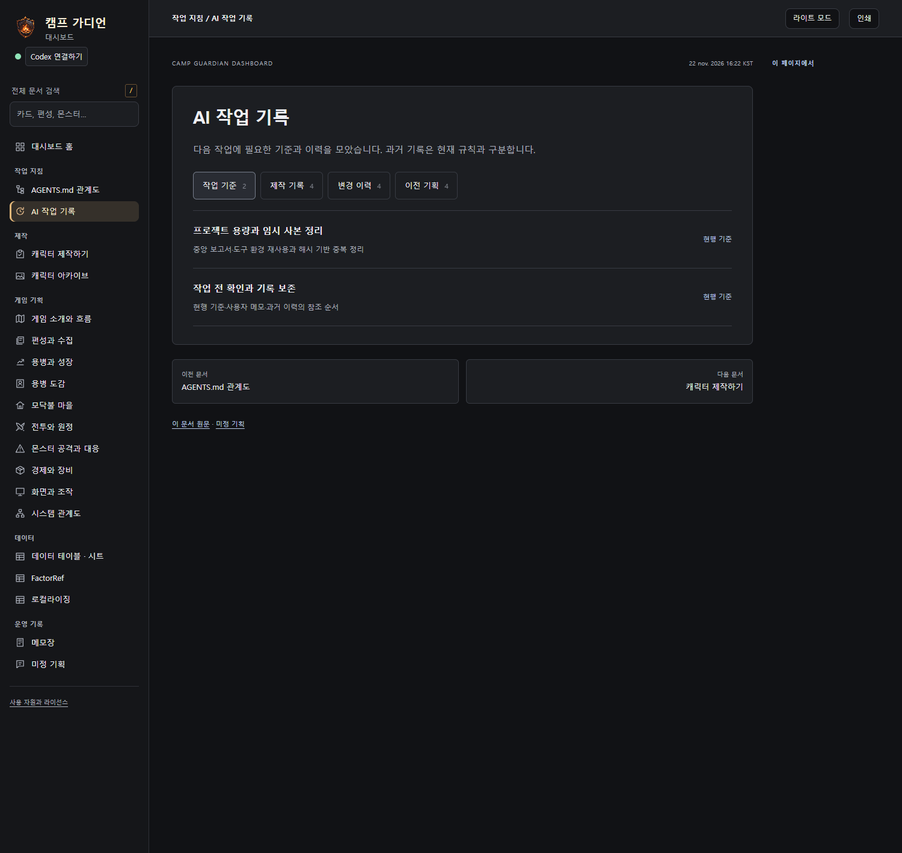

## 작업 결과

Markdown 26개와 기존 AI 기록 14개를 확인했습니다.

## 변경 내용

### 적용 내용

작업 지침 아래 독립 AI 작업 기록 탭을 두고 기존 기록·분류와 옛 링크를 보존했습니다. 관계도 아래의 요약 검토·업데이트 블록을 제거하고 모달 안의 개별 검토 상태를 유지했습니다. 작업과 검수, 대시보드 이용, Godot 구현 진입점 문서를 보강했습니다. 격자·균일한 카드·곡선 연결선을 적용했습니다. main f9744e1f를 푸시했습니다.

## 검증

빌드 성공. 실제 Chrome에서 다크 격자, 문서 노드 26개와 가로 넘침·글자 잘림 없음, 프로젝트 지침 및 Godot 문서 미리보기, AI 기록 14개 및 기존 기록 링크 호환을 확인했습니다. 중앙 최신 ID 2026-11-22-001을 원격 확인했습니다.

## 남은 사항

공개 배포와 모바일 실기기 표시는 미확인입니다.

## 작업 시간

- 제안 시간: 10분. 11월 22일 16:17 KST 시작.
- 실제로 완료된 시간: 11월 22일 16:23 KST까지 약 6분.
- XERJ: 미사용 — Node 빌드, Chrome 실행과 실제 화면 캡처.
