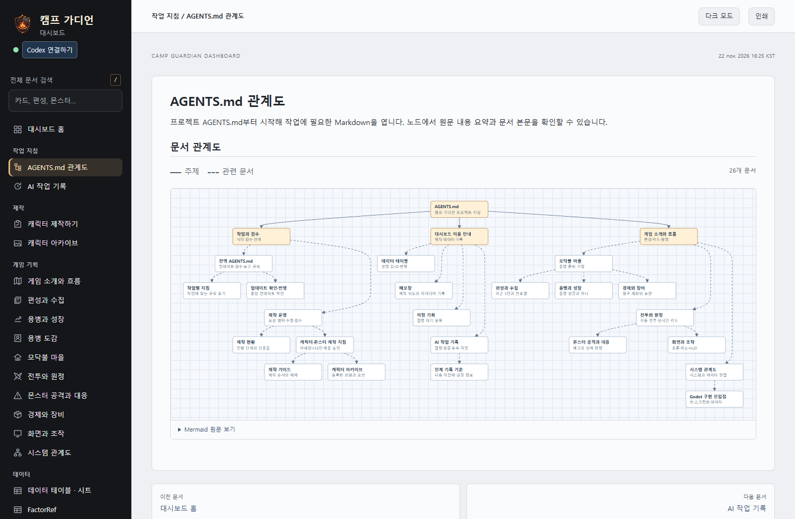

## 작업 결과

라이트 모드 전용 색상을 적용했습니다.

## 변경 내용

### 적용 내용

라이트 모드에서 밝은 청회색 격자, 흰 카드, 따뜻한 색의 상위 노드와 진한 연결선을 사용합니다. 다크 모드는 기존 색상을 사용합니다. main 23df7161에 푸시했습니다.

## 검증

Chrome에서 두 모드의 실제 색상 및 가로 넘침을 확인했습니다. 도형 내부 제목·설명 텍스트의 최소 대비는 라이트 6.16:1, 다크 6.78:1입니다. 중앙 최신 업데이트 2026-11-22-001을 원격 확인했습니다.

## 남은 사항

공개 배포 미확인.

## 작업 시간

- 제안 시간: 5분. 11월 22일 16:25 KST 시작.
- 실제로 완료된 시간: 11월 22일 16:26 KST까지 약 1분.
- XERJ: 미사용 — Node 빌드, Chrome 색상 비교 및 실제 캡처.
