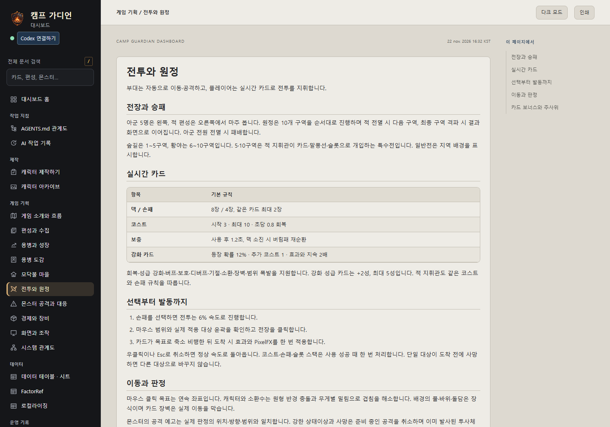

## 작업 결과

차콜 내비게이션과 낮춘 밝기의 본문 및 표를 적용했습니다.

## 변경 내용

### 적용 내용

공통 바탕·본문·표 교차 행·버튼·모달·관계도 격자 배색을 낮은 밝기의 온회색에 맞췄습니다. 차콜 내비게이션을 유지하고 다크 테마의 기존 표면 색을 보존했습니다. main facfcb5e에 푸시했습니다.

## 검증

19페이지 빌드 성공. 실제 Chrome에서 홈, 전투, FactorRef, 캐릭터 아카이브, AI 기록, 관계도와 모달의 라이트 표면 색을 확인했습니다. 다크 전환 기존 색상, 가로 넘침 없음과 중앙 최신 업데이트 2026-11-22-001을 확인했습니다.

## 남은 사항

실제 장시간 사용자 체감과 공개 배포는 미확인입니다.

## 작업 시간

- 제안 시간: 6분. 11월 22일 16:31 KST 시작.
- 실제로 완료된 시간: 11월 22일 16:32 KST까지 약 1분 30초.
- XERJ: 미사용 — Node 빌드, Chrome 화면 및 렌더링 색상 대조.
