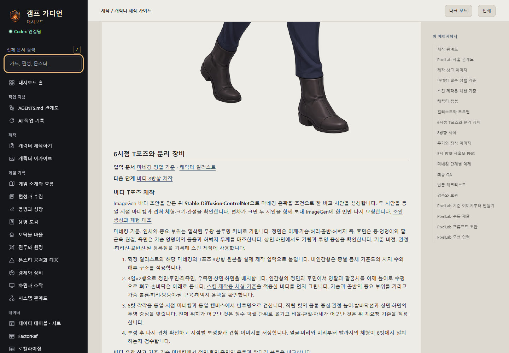

## 작업 결과

## 변경 내용

### 적용 내용

제작 관계도에서 4개 단계에 직접 연결하고, 큰 편차의 ImageGen 재요청 1회 기준과 장비 검수 범위를 단계 문서에 명시했습니다.

## 검증

헤드리스 Chrome에서 ControlNet 검색, 제작 가이드 노출, 4개 단계 링크 및 문구를 확인했습니다. 대시보드 빌드 9.62초, 로스터 렌더 67행. 프로젝트 main feacf2f7 푸시 확인.

## 남은 사항

공개 배포와 사용자 환경 브라우저 확인은 미확인입니다.

## 작업 시간

- 제안 시간: 초기 경로 확인과 접수 약 5분
- 실제로 완료된 시간: 2026-11-22 23:01:38 KST 초기 확인, 23:10:17 KST 보고 작성.
- XERJ: 미사용 — 로컬 대시보드와 프로젝트 파일 확인
