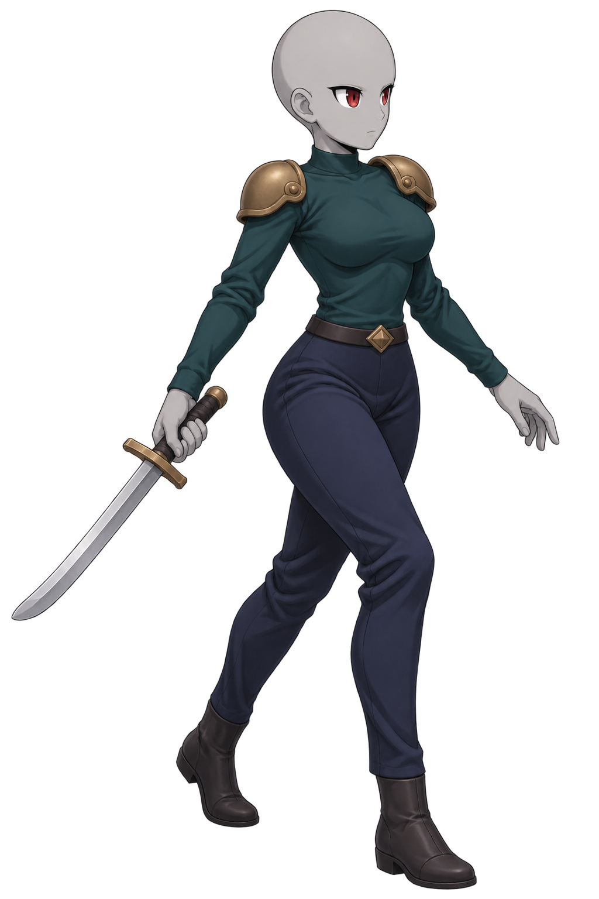
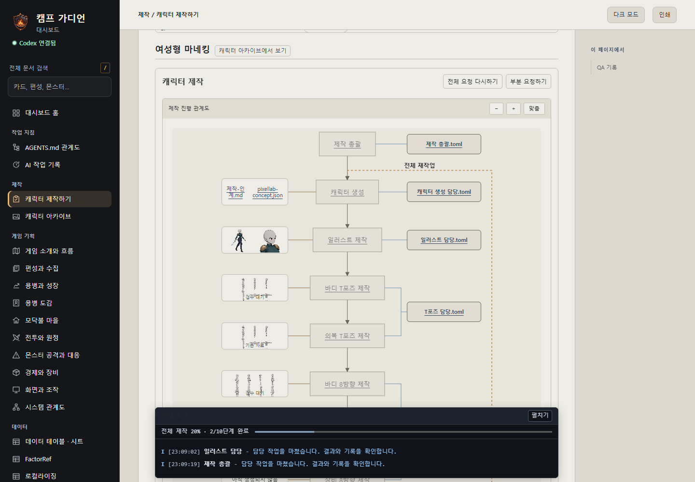

## 작업 결과

## 변경 내용

### 적용 내용

대시보드 부분 요청 f6242be0-faca-4e14-8c87-80cea853b1f4에서 설정·일러스트를 처리하고 남녀 전신 예제를 교체했습니다.

## 검증

여성 투명 PNG 2장과 입력·해시를 독립 대조했습니다. 실제 대시보드 진행 단계와 가이드 이미지 디코딩, 아카이브의 남녀 일러스트 등록을 확인했습니다. 이미지 2개 노출 증가, 초기 HTML 약 12KB 증가, 제작 데이터 약 2.4KB 증가, 로스터 67행. main feacf2f7 푸시 확인.

## 남은 사항

요청 범위는 설정·일러스트이며 여성 T포즈·8방향·PixelLab과 공개 배포는 미확인입니다.

## 작업 시간

- 제안 시간: 초기 접수 약 5분, 이미지 생성 및 별도 검수 별도
- 실제로 완료된 시간: 2026-11-22 23:02:13~23:09:19 KST, 7분 6초.
- XERJ: 미사용 — 로컬 대시보드와 프로젝트 파일 확인
