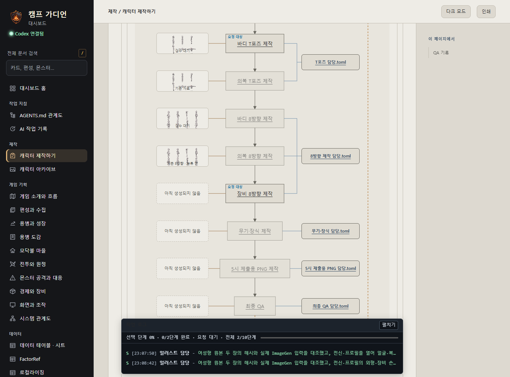
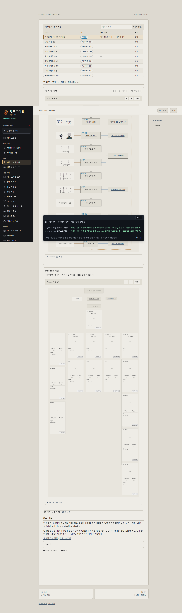

## 작업 결과

캐릭터 제작하기에서 필요한 제작 단계만 골라 요청할 수 있습니다. 전체 요청은 10개 제작 단계에 모두 표시됩니다.

## 변경 내용

### 적용 내용

부분 요청 UI와 Codex 제작 논의가 같은 단계 목록을 사용합니다. 접수 서버는 목록을 제작 순서대로 저장하며 기존 범위 입력도 처리합니다. 프로젝트 main 79d54fbc 푸시 완료.

## 검증

Chrome에서 비연속 두 단계 선택, 세 번째 단계 선택 취소, 확인 문구, 실제 접수 함수가 저장한 단계 목록, 접수 대기 배지 2개와 전체 진행 배지 10개를 검증했습니다. 브라우저 검증은 작업자 실행 응답을 대체했습니다. 기존 범위 입력도 직접 확인했습니다. 캡처는 11월 22일 23:26 KST입니다. 대시보드 빌드 통과. 초기 HTML 3,536,429바이트, 추가 표시 최대 10개.

## 남은 사항

실제 백그라운드 제작 작업과 공개 배포는 미확인입니다. 전역 업데이트는 로컬 2026-11-22-003을 확인했으며 원격 최신은 미확인입니다.

## 작업 시간

- 제안 시간: 약 10분. 11월 22일 23:21 KST 시작.
- 실제로 완료된 시간: 11월 22일 23:26 KST에 구현·검증·프로젝트 푸시 완료. 약 5분.
- XERJ: 미사용 — rg, Node, Chrome으로 확인.
