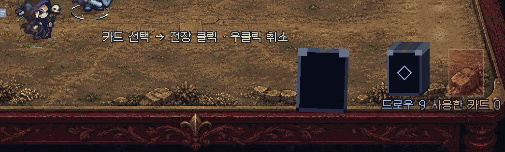

## 작업 결과

Godot 전투 HUD에 적용하고 프로젝트 main에 0f3f5570을 푸시했습니다.

## 변경 내용

### 적용 내용

우하단 주사위 UI 자리에 드로우 더미와 사용한 카드 더미를 배치했습니다. 시작 손패는 4장을 순서대로 뽑고 보충 카드도 드로우 더미에서 뒤집혀 손패로 이동합니다. 손패에 도착한 카드만 사용할 수 있으며 연출 감소 설정은 즉시 지급합니다. 사용 성공 시 오른쪽 더미의 장수와 마지막 카드 그림을 갱신합니다. 덱 소진 시 사용한 카드를 섞는 기존 규칙을 유지합니다.

## 검증

Godot 4.7.2에서 사용 성공 후 덱 6장·사용 1장·손패 3장, 보충 후 덱 5장·사용 1장·손패 4장을 확인했습니다. 분리 데스크톱 렌더에서 입력 데스크톱이 Default로 유지됐으며 GIF 35프레임이 모두 달랐습니다. 대시보드 빌드 2.70초, 초기 HTML 3,539,854바이트(+3,425), 지연 로드 캡처 2개 3,275,321바이트 추가. Chrome 헤드리스에서 전투·화면과 조작의 캡처 2개를 표시하고 두 섹션의 안내 캡처가 각각 2개·5개임을 확인했습니다. 

## 남은 사항

특정 카드를 사용한 카드 더미에서 다시 가져오는 효과는 후속 기획입니다. 게임 패키지 빌드와 배포, 공개 Pages와 모바일 재생은 미확인입니다.

## 작업 시간

- 제안 시간: 10분
- 실제로 완료된 시간: 2026-11-22 23:28~23:35 KST, 구현·실행·대시보드 검수 약 7분.
- XERJ: 미사용 — Godot 뷰포트 캡처와 Chrome 헤드리스로 확인했습니다.
