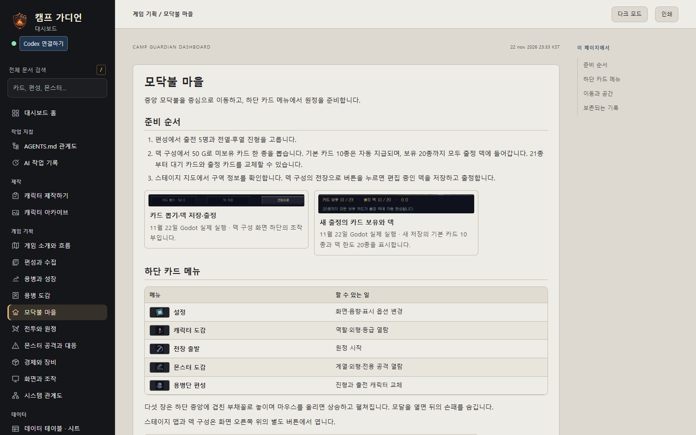
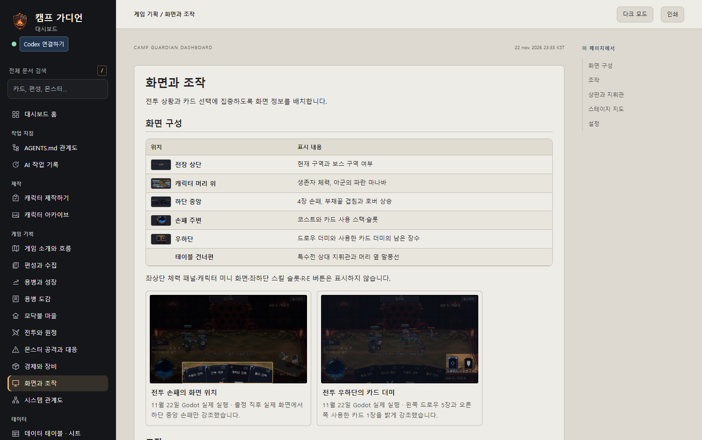

## 작업 결과

## 변경 내용

### 적용 내용

기존 Godot 캡처와 게임 아이콘을 재사용했습니다. 표 첫 칸의 44×24 미리보기와 정렬을 적용했습니다. 프로젝트 main c5bcd62b 푸시.

## 검증

19페이지 빌드 2.67초. Chrome에서 게임 소개·마을·전투·편성·경제·화면과 조작의 26행이 모두 로드되고 390px 가로 넘침이 없음을 확인했습니다. 새 WebP 19,868B, 초기 HTML +9,472B·gzip +1,360B, 새 표 행 추가 0, 지연 로딩. 중앙 업데이트 2026-11-22-003을 원격 확인했습니다.

## 남은 사항

공개 배포와 모바일 실기기는 미확인입니다. 기존 게임 캡처를 사용해 새 게임 실행은 필요하지 않았습니다.

## 작업 시간

- 제안 시간: 6분. 11월 22일 23:33 KST 시작.
- 실제로 완료된 시간: 11월 22일 23:36 KST까지 약 3분 30초.
- XERJ: 미사용 — 원본 게임 캡처, Node 빌드, 실제 Chrome 렌더.
