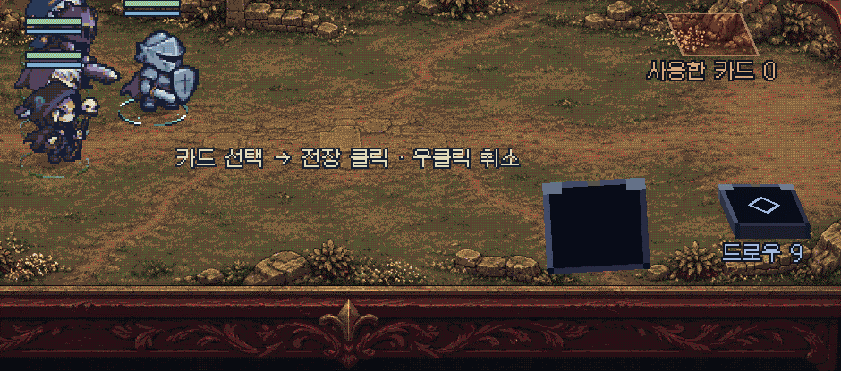

## 작업 결과

Godot 전투 HUD와 캠프 가디언 대시보드에 적용했습니다. 프로젝트 main에 4b808eb5를 푸시했습니다.

## 변경 내용

### 적용 내용

두 더미의 카드 면에 공통 상판 투영을 적용하고 장수에 따라 높이를 쌓습니다. 보충 카드가 가까운 더미 위에서 출발하도록 연결했습니다. 실제 위치를 강조한 전체 화면과 드로우 GIF를 대시보드에 등록했습니다.

## 검증

Godot 4.7.2 분리 데스크톱에서 11월 22일 드로우와 카드 사용을 캡처했습니다. 사용 시 건너편 더미 1장, 보충 시 가까운 더미 6→5장과 손패 3→4장을 확인했습니다. GIF 25프레임이 모두 달랐습니다. Chrome 헤드리스에서 전투와 화면과 조작 캡처가 표시됐습니다. 빌드 3.23초, 초기 HTML +400바이트, 지연 로드 캡처 참조 용량 +70,324바이트, 대상 섹션 캡처 2개와 5개입니다. 

## 남은 사항

게임 패키지 빌드·배포와 공개 Pages·모바일 재생은 미확인입니다.

## 작업 시간

- 제안 시간: 8분
- 실제로 완료된 시간: 2026-11-22 23:41~23:44 KST, 약 3분. 구현·Godot 실행·대시보드 검수·프로젝트 푸시 기준.
- XERJ: 미사용 — Godot 렌더와 Chrome 헤드리스 확인.
