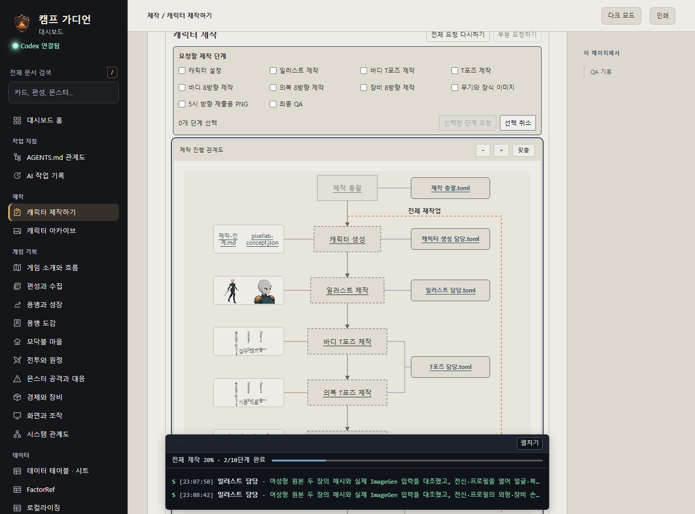

## 작업 결과

부분 요청을 열면 관계도 위에 10개 단계 체크박스가 표시됩니다.

## 변경 내용

### 적용 내용

체크와 해제 즉시 선택 개수 및 관계도 강조를 동기화합니다. 확인 후 체크한 단계만 접수합니다. 프로젝트 main fb5c3c53 푸시.

## 검증

Chrome에서 세 단계 체크 후 한 단계 해제, 두 단계의 확인 문구와 접수 함수의 저장 결과, 관계도 요청 표시를 확인했습니다. 테스트용 실행 응답을 사용했습니다. 11월 22일 23:47 KST 캡처. 대시보드 빌드 3.10초, 초기 HTML 3,549,431B, 체크박스 최대 10개와 GIF 533,376B.

## 남은 사항

실제 백그라운드 작업 실행과 공개 배포는 미확인입니다. 전역 업데이트는 로컬 2026-11-22-004까지 확인했고 원격 최신은 미확인입니다.

## 작업 시간

- 제안 시간: 11월 22일 23:46 KST 시작, 약 5분.
- 실제로 완료된 시간: 11월 22일 23:48 KST 구현·브라우저 검증·프로젝트 푸시 완료, 약 2분.
- XERJ: 미사용 — rg, Node, Chrome 사용.
