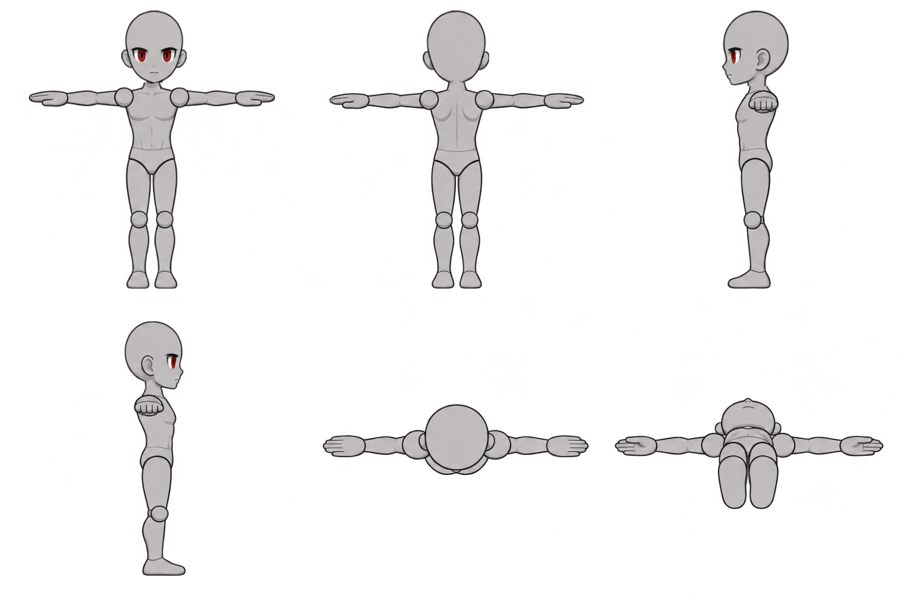
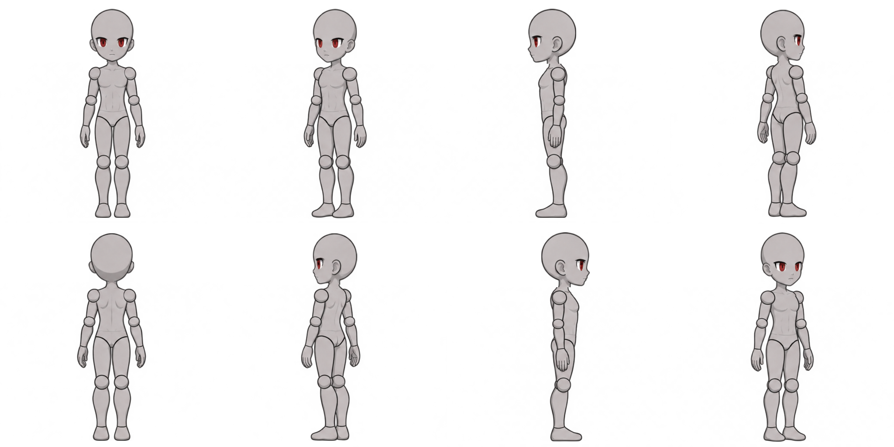

## 작업 결과

## 변경 내용

### 적용 내용

두 바디 슬롯에 예제 표기와 기존 원본 경로를 등록했습니다. 프로젝트 b2241408 푸시.

## 검증

대시보드 빌드 및 브라우저에서 두 예제의 로딩과 표시를 확인했습니다.

## 남은 사항

공개 배포 미확인.

## 작업 시간

- 제안 시간: 5분
- 실제로 완료된 시간: 약 3분, 23:48 KST 프로젝트 반영.
- XERJ: 미사용 — 대시보드 빌드와 브라우저 확인
