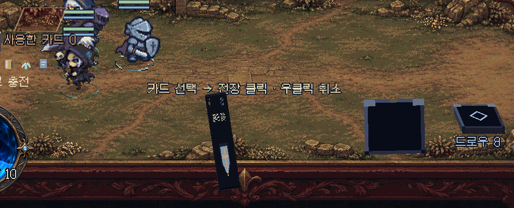

## 작업 결과

Godot 전투와 캠프 가디언 대시보드 캡처를 갱신했습니다. 프로젝트 main에 74fc6455를 푸시했습니다.

## 변경 내용

### 적용 내용

사용한 카드 더미의 위치와 왼쪽 상판 원근 방향을 반영했습니다. 전투·조작 문서와 캡처를 갱신했습니다.

## 검증

Godot 실제 전투에서 카드 사용 후 건너편 왼쪽 1장, 보충 후 오른쪽 드로우 5장·손패 4장을 확인했습니다. 18프레임의 GIF는 전부 다른 프레임입니다. 대시보드 빌드 2.87초, 초기 HTML 로컬 빌드 전후 +87바이트, 지연 로드 캡처 참조 용량 +613,449바이트. Chrome 헤드리스에서 전투·화면과 조작 캡처의 표시를 확인했습니다. 

## 남은 사항

게임 패키지 배포와 공개 Pages는 미확인입니다.

## 작업 시간

- 제안 시간: 5분
- 실제로 완료된 시간: 2026-11-22 23:46~23:48 KST, 구현·Godot 검수·프로젝트 푸시 약 2분.
- XERJ: 미사용 — Godot 실제 렌더와 로컬 대시보드.
