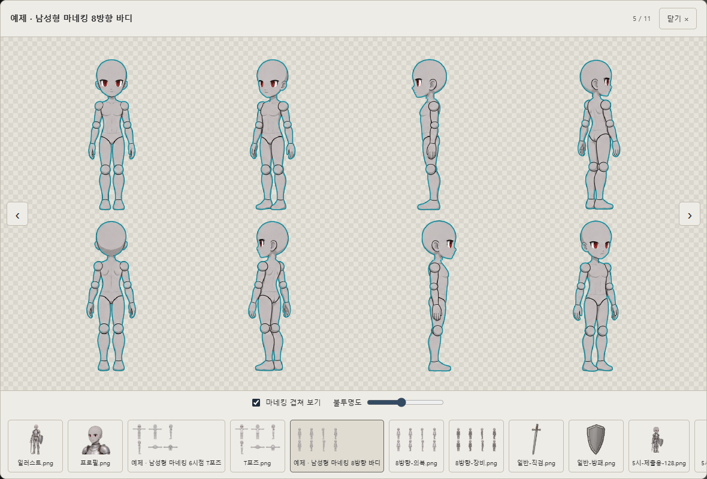

## 작업 결과

## 변경 내용

### 적용 내용

공통 비교 이미지 역할을 추가했습니다. 프로젝트 d2bfb5eb 푸시.

## 검증

브라우저에서 남성형 바디와 의복 T포즈, 바디·의복·장비 8방향 총 5개 비교 레이어를 켜서 확인했습니다.

## 남은 사항

공개 배포 미확인.

## 작업 시간

- 제안 시간: 5분
- 실제로 완료된 시간: 약 2분, 23:59 KST
- XERJ: 미사용 — 브라우저 렌더링과 비교 레이어 캡처
