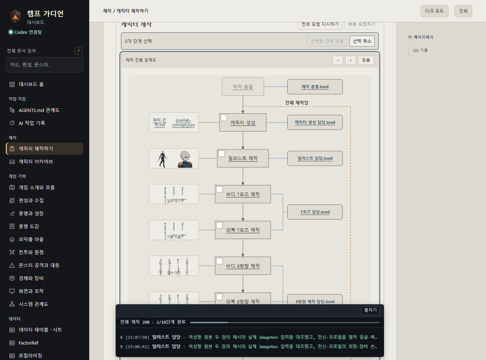

## 작업 결과

별도 체크 목록을 제거하고 각 단계 도형에 체크박스를 배치했습니다.

## 변경 내용

### 적용 내용

부분 요청에서 도형 내 체크박스를 마우스나 키보드로 선택합니다. 접수 뒤에는 체크박스 위치에 요청 대상 표시가 나옵니다. 프로젝트 main 9ee35291 푸시.

## 검증

Chrome에서 체크박스 10개가 모두 도형 내부에 있고 선택 영역에 별도 체크 목록이 없는 것을 확인했습니다. 마우스와 스페이스 키로 떨어진 두 단계를 골라 접수 함수에 전달하고 두 배지를 확인했습니다. 검증용 실행 응답을 사용했습니다. 11월 23일 00:01 KST 캡처. 빌드 약 4.6초. 초기 HTML 3,549,653B, 체크박스 최대 10개, GIF 513,579B.

## 남은 사항

실제 백그라운드 제작 실행과 공개 배포 미확인. 중앙 업데이트는 로컬 2026-11-22-004까지 확인했고 원격 최신은 미확인입니다.

## 작업 시간

- 제안 시간: 11월 22일 23:59 KST 시작, 약 5분.
- 실제로 완료된 시간: 11월 23일 00:01 KST 구현·검증·프로젝트 푸시 완료, 약 2분.
- XERJ: 미사용 — rg, Node, Chrome 사용.
