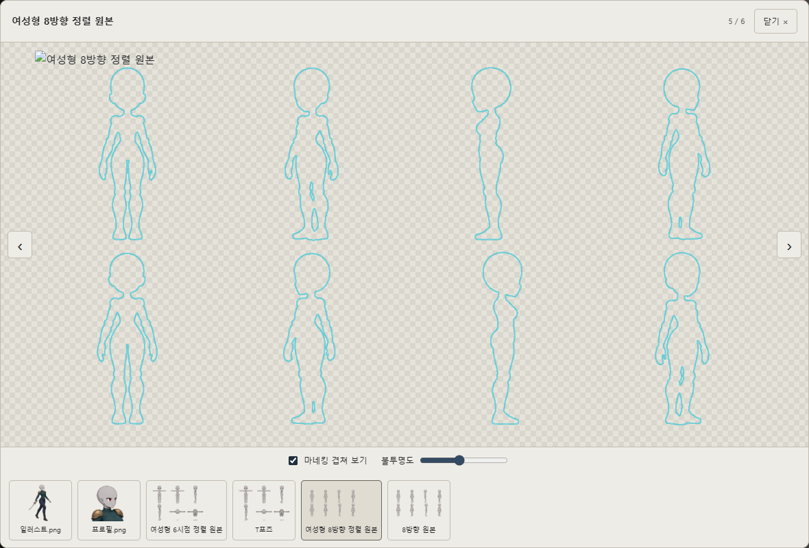

## 작업 결과

## 변경 내용

### 적용 내용

캐릭터 등록에 기준 마네킹 필드를 추가하고 단계별 검수 비교 이미지를 우선합니다. 프로젝트 a4d3825b 푸시.

## 검증

대시보드 빌드, 여성형·남성형 바디 T포즈와 8방향, 기존 남성형 의복 비교 이미지, 별도 신규 ID에서 기준 윤곽 표시 확인.

## 남은 사항

공개 배포 및 전역 업데이트 원격 상태 미확인.

## 작업 시간

- 제안 시간: 5분
- 실제로 완료된 시간: 약 3분, 00:03 KST 프로젝트 푸시.
- XERJ: 미사용 — 브라우저 렌더링 및 캡처
