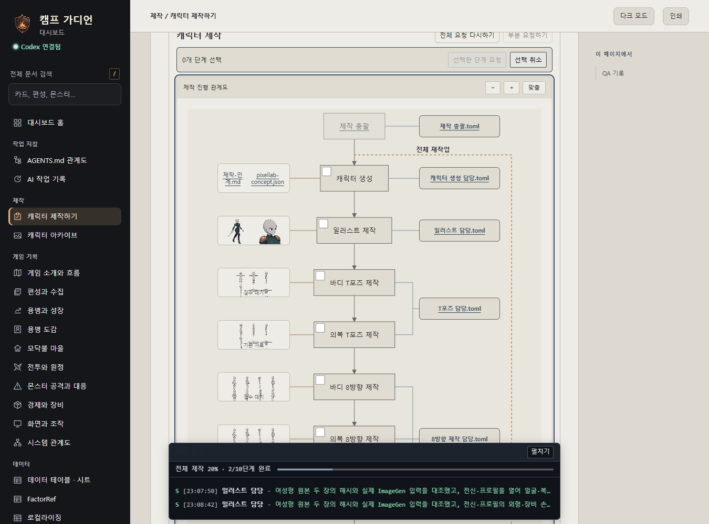

## 작업 결과

체크박스 동작과 일반 모드의 문서 열기를 분리했습니다.

## 변경 내용

### 적용 내용

부분 요청의 단계 도형에서 링크 래퍼를 제거하고 체크박스 클릭 이벤트 전파를 막습니다. 프로젝트 main 487a7a73 푸시. 같은 파일에서 동시에 작업 중이던 마네킹 참조 변경도 해당 커밋에 포함됐습니다.

## 검증

Chrome에서 일반 모드의 도형 링크로 문서를 열었습니다. 선택 중에는 링크 조상과 문서까지 전달된 체크박스 이벤트가 없고, 마우스·키보드 체크 후 URL과 문서 모달 상태가 그대로이며 선택 단계가 접수됨을 확인했습니다. 11월 23일 00:10 KST 캡처. 대시보드 빌드 7.95초, 초기 HTML 3,550,227B, 추가 UI 요소 없음, GIF 186,684B.

## 남은 사항

실제 제작 실행과 공개 배포 미확인. 중앙 지침은 로컬 2026-11-22-004 확인, 원격 최신 미확인.

## 작업 시간

- 제안 시간: 11월 23일 00:09 KST 시작, 약 4분.
- 실제로 완료된 시간: 11월 23일 00:11 KST 구현·검증·프로젝트 푸시 완료, 약 2분.
- XERJ: 미사용 — rg, Node, Chrome 사용.
